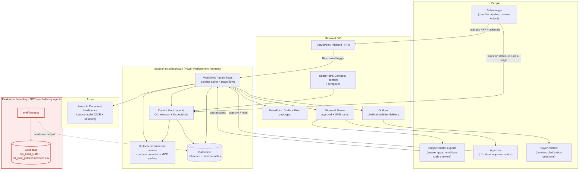
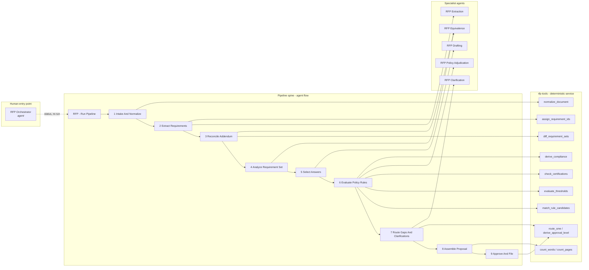
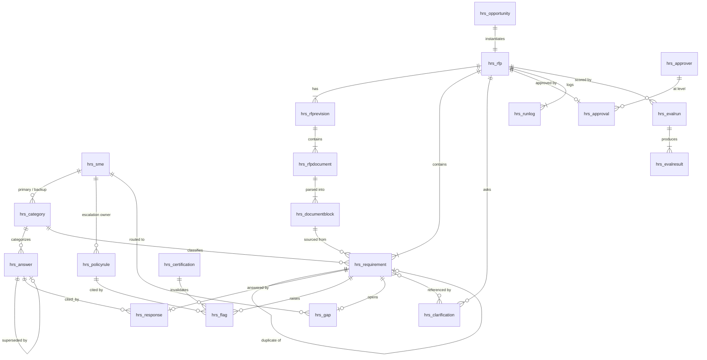
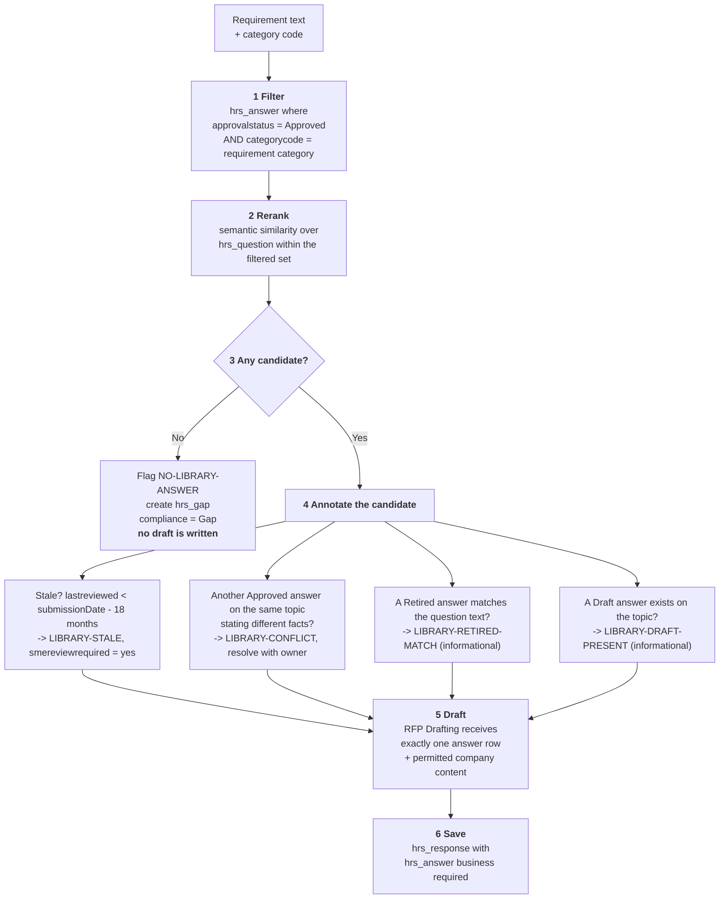
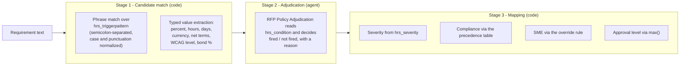
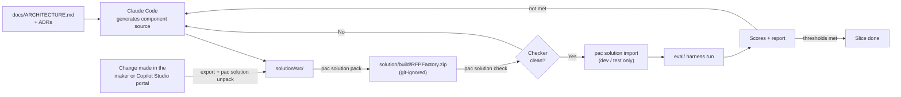

# Proposal & RFP Response Factory — Architecture

**Status:** Draft for review · **Version:** 0.1 · **Date:** 2026-10-28
**Owner:** Solution architecture · **Supersedes:** nothing

> This document is the source of truth for the design. When an implementation differs from this
> document, change the document in the same commit.
>
> Platform capabilities were verified against Microsoft Learn on 2026-10-27/28. Anything that
> could not be verified is marked **[UNVERIFIED]** inline and repeated in §17.

---

## Table of contents

1. [Purpose, scope and non-goals](#1-purpose-scope-and-non-goals)
2. [Context diagram](#2-context-diagram)
3. [Component view](#3-component-view)
4. [End-to-end sequence](#4-end-to-end-sequence)
5. [Data model](#5-data-model)
6. [Document processing strategy per format](#6-document-processing-strategy-per-format)
7. [Retrieval and grounding design](#7-retrieval-and-grounding-design)
8. [Policy engine design](#8-policy-engine-design)
9. [Human-in-the-loop points](#9-human-in-the-loop-points)
10. [Guardrails and hooks](#10-guardrails-and-hooks)
11. [Security and identity](#11-security-and-identity)
12. [ALM](#12-alm)
13. [Evaluation harness](#13-evaluation-harness)
14. [Non-functional requirements](#14-non-functional-requirements)
15. [Licensing and environment prerequisites](#15-licensing-and-environment-prerequisites)
16. [Phased build plan](#16-phased-build-plan)
17. [Risks, assumptions and open questions](#17-risks-assumptions-and-open-questions)
18. [Architecture Decision Record index](#18-architecture-decision-record-index)

---

## 1. Purpose, scope and non-goals

### 1.1 Purpose

Turn an inbound Request for Proposal — in Word, native PDF or scanned PDF (Excel questionnaires are out of scope, [ADR-0024](adr/0024-rfp-c-excel-questionnaire-out-of-scope.md)),
with any addenda — into a reviewed, approved and filed proposal package, with a complete audit
trail of where every answer came from and why every compliance value was chosen.

The system exists to remove three specific failure modes from manual bid work:

| Failure mode | How the system removes it |
|---|---|
| A requirement is missed, or answered twice inconsistently | Every requirement becomes a row with a stable ID and a source location; duplicates are detected and cross-referenced |
| An answer is reused that is retired, unapproved, stale or contradicted by another approved answer | Answer selection is a filtered query, not a search; the answer ID is stored with the response and cannot be omitted |
| A commitment is made that breaches an approved commercial, legal or security position | Every requirement is matched against the policy rule register and the certification register before drafting |

### 1.2 In scope

1. Ingest an RFP in `.docx`, native `.pdf`, `.xlsx` or scanned (image-only) `.pdf`, plus addenda.
2. Produce a requirements matrix: ID, source location, section, category, mandatory/desirable, weight.
3. Reconcile addenda: modified, deleted, added and promoted requirements, plus date and page/word-limit changes.
4. Detect duplicates, contradictions, ambiguous requirements and out-of-scope requirements.
5. Select approved answers from the answer library, excluding retired and draft entries, flagging stale entries and conflicting approved pairs, and never reusing text from past proposals as a source of fact.
6. Evaluate every requirement against the policy rule register (Block / Warn / Info) and the certification and insurance register.
7. Route gaps to the right subject-matter expert (SME) and draft clarification questions for the buyer.
8. Assemble a Word proposal and a compliance matrix from the templates, within page and word limits.
9. Obtain one human approval at the level set by the approver matrix, then file the output to SharePoint.
10. Score any run against the gold data set and report the result.

### 1.3 Non-goals

| Non-goal | Why |
|---|---|
| Pricing, cost proposals and the price forms | Commercial pricing is owned outside this system; the system only records that a price form is a required form |
| Go / no-go qualification and bid scoring | The dataset's `hrs_opportunity.hrs_gonogo` is an **input**; the decision is made by the bid team |
| Submission to the buyer's portal, email or physical delivery | Final submission stays a human act; the system files the approved package to SharePoint |
| E-signature of forms and affidavits | Out of scope; forms are tracked as a checklist |
| Non-US data residency, non-English RFPs | US English and US hosting only, matching the data set's stated assumptions |
| Editing the answer library | The system *proposes* library additions from SME answers; promotion to an approved entry stays a human, owner-driven act |
| Replacing the proposal writer | Output is a reviewed draft, not a submitted document |

### 1.4 Design principles

1. **Deterministic where exactness matters.** Word counts, page counts, date and threshold
   comparisons, requirement ID assignment, compliance derivation, SME routing and approval level
   are code. See [ADR-0006](adr/0006-compliance-value-and-approval-level-are-code.md).
2. **Enforce, don't prompt.** A rule that must hold is a query filter, a required lookup or a
   schema constraint — never only a sentence in an agent instruction.
3. **Company-agnostic.** No vendor, customer or partner name appears in an agent instruction,
   table name, flow name or component name. Company facts live in Dataverse and SharePoint.
4. **Every claim is traceable.** A drafted response carries its answer ID; a requirement carries
   its page, section and row; a flag carries its rule ID.
5. **Fail loud.** Low-confidence extraction, an unresolvable conflict or a missing answer becomes
   a visible flag and a work item, never a silently plausible sentence.

---

## 2. Context diagram



The red boundary is architectural, not advisory. See §10.3 and
[ADR-0007](adr/0007-gold-data-isolation-by-architecture-not-by-prompt.md).

---

## 3. Component view

### 3.1 Shape of the system

The brief's starting hypothesis was a hub-and-spoke of seven specialist **agents** under an
orchestrator **agent**. This design rejects that shape for the pipeline itself.

Microsoft's own guidance on the orchestrator/sub-agent pattern says not to use it when "the use
case requires a consistent success rate (compliance or Q&A use cases)" or when "the process
includes well-defined steps and strong hierarchical dependencies"
([orchestrator and subagent patterns](https://learn.microsoft.com/en-us/microsoft-copilot-studio/guidance/architecture/multi-agent-orchestrator-sub-agent)).
An RFP response factory is both: it is a compliance use case, and its nine stages run in a fixed
order with hard dependencies.

The cost model points the same way. At the published rates
([billing rates](https://learn.microsoft.com/en-us/microsoft-copilot-studio/requirements-messages-management)),
an **agent action** — which includes a tool call the model chooses to make — is **5 Copilot
Credits**, while **agent flow actions** cost **13 Copilot Credits per 100 actions**, about
**0.13 credits each**. Moving a deterministic step out of the model's hands and into the flow is
roughly **38× cheaper** and removes a decision the model can get wrong. With 311 requirements
across the four test RFPs and several deterministic steps per requirement, this is not a rounding
difference.

So the shape is a **deterministic spine with agents at the leaves**:

- A **pipeline workflow** (`RFP - Run Pipeline`) executes the nine stages in order, writes state
  to Dataverse after each stage, and is restartable at any stage.
- Each stage calls **prompts** as *steps* using `Run a prompt`, which returns typed JSON
  validated against a strict schema. The flow decides *when*; the prompt decides *what to write*.
  *(Changed 2026-10-28 by [ADR-0015](adr/0015-leaf-steps-are-prompts-called-by-agent-flows.md).
  The original design called agents through the agent node, which returns free text only and is
  documented for the standard harness.)*
- One **conversational agent** (`RFP Orchestrator`) is the human entry point. It does not drive
  the pipeline; it reports on it and can ask the spine to re-run a stage or a single requirement.

Full reasoning: [ADR-0001](adr/0001-deterministic-workflow-spine-agents-at-the-leaves.md).

### 3.2 Diagram



### 3.3 Agents

> **Superseded for the pipeline by [ADR-0015](adr/0015-leaf-steps-are-prompts-called-by-agent-flows.md)
> (2026-10-28).** The five specialist roles below are now implemented as **prompts** called from
> agent flows: `RFP Classify Requirement` and `RFP Extract RFP Facts` (Extraction), `RFP Judge
> Relation` (Equivalence), `RFP Adjudicate Rule` (Policy Adjudication), `RFP Select Answer` and
> `RFP Draft Response` (Drafting), and `RFP Draft Clarification` (Clarification). The table still
> describes each role's responsibility, inputs and outputs. `RFP Orchestrator` stays an agent, built
> in Slice 7 on the GitHub Copilot harness with four workflow tools and two hooks
> ([ADR-0030](adr/0030-rfp-orchestrator-and-hooks.md)).

Five specialists plus one orchestrator. Each exists because a step needs language judgment that
code cannot supply. Nothing else is an agent.

| Agent | Responsibility | Inputs | Outputs | Triggered by | Why an agent |
|---|---|---|---|---|---|
| **RFP Orchestrator** | Human entry point: run status, explain a flag, re-run a stage or a single requirement, answer "why did we answer CV-013 this way" | User prompt; read access to runtime tables | Natural-language answers; stage re-run requests | User, in Teams | Open-ended conversation; no fixed script |
| **RFP Extraction** | Decide where a requirement starts and ends in prose, and classify it (category, mandatory/desirable) | Normalized document blocks with page/section/row; the 12-category taxonomy | Candidate requirements with text, block references, category, mandatory flag, confidence | Stage 2, per document section | Requirement boundaries in prose (RFP B) and noisy OCR (RFP D) are a judgment call |
| **RFP Equivalence** | Judge semantic relations between requirements: duplicate, contradiction, ambiguity, out-of-scope, and addendum reword matching | Requirement pairs or clusters shortlisted deterministically; approved-position context for out-of-scope | Relation verdicts with a one-line reason | Stages 3 and 4 | "Worded differently but the same requirement" and "these two contradict" are language judgments |
| **RFP Policy Adjudication** | Decide whether a candidate rule hit genuinely satisfies the rule's `hrs_condition` | Requirement text; candidate rule with trigger, condition, approved position; extracted numeric values | Fired / not fired, with a reason | Stage 6, per candidate hit | The trigger phrase has recall; the condition needs reading |
| **RFP Drafting** | Write the response text for one requirement from exactly one selected approved answer plus permitted company content | Requirement; the selected `hrs_answer` row; approved company content for the category; buyer response-code vocabulary; word limit | Response text, chosen response code, word count | Stage 5, per requirement | The genuinely generative step |
| **RFP Clarification** | Draft the question to the buyer for an ambiguous or contradictory requirement | The requirement(s), the relation verdict and reason, the clarification letter template | Question text referencing the requirement IDs | Stage 7 | Writing a precise, polite, answerable question |

Agents receive **no free-roaming knowledge source over the answer library**. See §7 and
[ADR-0004](adr/0004-answer-retrieval-filtered-candidate-set-not-knowledge-rag.md).

### 3.4 Workflows

Named `RFP - <Verb> <Object>` per the naming convention. **Revised 2026-10-29
([ADR-0018](adr/0018-one-pipeline-flow-chained-through-dataverse.md)):** the per-stage flows of
the original design are scopes inside one pipeline flow, and the human waits hand back to it
through Dataverse row changes.

| Workflow | Type | Responsibility | Trigger |
|---|---|---|---|
| `RFP - Receive Inbound Document` | Agent flow | Detect a new file in the inbound folder, identify format, create `hrs_rfp` / `hrs_rfprevision` / `hrs_rfpdocument`, set the RFP to Running | SharePoint *When a file is created* |
| `RFP - Run Pipeline` | Agent flow | The spine. One scope per stage (1-9), each guarded by `hrs_stage`, writing `hrs_runlog` and checking its gate. Stage 7 drafts the clarification letter and writes the gaps; stage 8 fills the templates, converts to PDF, counts pages and enforces limits; stage 9 writes `hrs_approval`. Stops at *Awaiting human* after stages 7 and 9 | `hrs_rfp.hrs_status` changes to Running (concurrency 1) |
| `RFP - Route Gap To SME` | Cloud flow | Post the gap card (to `hrs_PilotRecipientUpn` in the pilot), wait, record the answer and propose a Draft library entry; set the RFP back to Running when no gap is still Routed | `hrs_gap` row created (parallel) |
| `RFP - Request Approval` | Cloud flow | Post the approval card, wait; approve copies the package to `Output/Filed` and completes the RFP, reject returns it to stage 8 with comments | `hrs_approval` row created |
| `RFP - Verify OCR Requirement` | Cloud flow | OCR verification card with the page crop; confirm or correct; resume at stage 3 when none is open (ADR-0025) | `hrs_flag` row created (OCR-LOW-CONFIDENCE) |
| `RFP - Get Run Status`, `RFP - Explain Flag`, `RFP - Explain Answer`, `RFP - Rerun Stage` | Agent flow | The Orchestrator's tools (ADR-0030) | *When an agent calls the flow* |
| `RFP - Hook Pre Tool Use` | Agent flow | Hook action: deny a rerun the tool would refuse (running, filed, stage out of range) | Copilot Studio *Pre tool use* event, scoped to Rerun Stage |
| `RFP - Hook Post Tool Use` | Agent flow | Hook action: write the audit record to `hrs_runlog` | Copilot Studio *Post tool use* event |

*As built (Slice 5 and 7):* stage 3 is a scope inside `RFP - Run Pipeline`, not a separate flow. The After tool
failure hook was dropped, because the tools report their own failures (ADR-0030). Every card flow waits with a reminder
and an escalation (ADR-0027).

The pipeline is an **agent flow** (billed through Copilot Studio, no per-user Power Automate
license). Flows that must wait on a human for hours or days — SME routing and final approval —
are **Power Automate cloud flows**, because they use the Teams `Post adaptive card and wait for a
response` action and should not sit against Copilot Studio capacity while idle.
See [ADR-0001](adr/0001-deterministic-workflow-spine-agents-at-the-leaves.md) and
[ADR-0018](adr/0018-one-pipeline-flow-chained-through-dataverse.md).

### 3.5 Deterministic service: `rfp-tools`

One codebase under `tools/`, exposed two ways: as a **custom connector** so workflows can call it
as ordinary actions, and as an **MCP server** so agents can call the same operations as tools
([extend your agent with MCP](https://learn.microsoft.com/en-us/microsoft-copilot-studio/agent-extend-action-mcp)).
**[UNVERIFIED]** — whether one artifact can serve both surfaces, or whether two thin wrappers over
a shared library are needed. Either way the logic is written once.

| Operation | Contract | Why deterministic |
|---|---|---|
| `normalize_document` | file → ordered blocks `{page, section, blockType, text, rowRef, polygon, confidence}` | Location must be exact and reproducible |
| `assign_requirement_ids` | blocks + buyer IDs → requirement IDs in document order | ID assignment must be stable across re-runs |
| `match_rule_candidates` | requirement text + rule register → candidate rule IDs | Phrase matching with normalization; high recall, no creativity |
| `evaluate_thresholds` | requirement text → typed numeric values (percent, hours, days, currency, WCAG level) and comparisons | "99.95% > 99.9%" is arithmetic, not opinion |
| `check_certifications` | certification register + submission date → valid / expired per certificate | A date comparison |
| `diff_requirement_sets` | revision N-1, revision N → Modified / Deleted / Added / Promoted | A set difference over stable keys |
| `count_words` | text → word count under the **buyer's own counting rule** | See §6.4 — the rule is not "split on whitespace" |
| `count_pages` | rendered PDF + inclusion rules → governed page count | Page limits are hard rejection criteria |
| `derive_compliance` | flags + status + answer presence → one of six compliance values | A precedence table (§8.4) |
| `route_sme` | category + fired rules → SME | A documented override rule (§9.1) |
| `derive_approval_level` | value band + flag severities → L1-L4 | A max() over two lookups (§9.3) |

### 3.6 Knowledge sources

| Source | Attached to | Contents | Limit relevance |
|---|---|---|---|
| Company content library (SharePoint) | `RFP Drafting` | Company overview, product sheets, services sheet, case studies, team bios, insurance and legal facts | Max 25 SharePoint site URLs per agent under generative orchestration |
| Templates library (SharePoint) | `RFP Clarification`, read by `RFP - Assemble Proposal` | Proposal, compliance matrix, clarification letter, Adaptive Card | — |
| Reference data (Dataverse) | `RFP Orchestrator` (read) | Taxonomy, SME directory, approver matrix, opportunities | Max 2 Dataverse knowledge sources per agent, 15 tables each |
| Answer library (Dataverse) | **Not a knowledge source** | Reached only through the filtered query in §7 | — |
| Past proposals | **Not a knowledge source** | Metadata only, as evidence of prior use; their text contains since-retired statements | — |
| Gold data | **Never attached to anything** | — | §10.3 |

Quotas verified: 500 knowledge sources per agent, 500 uploaded files, 512 MB upload limit, 25
SharePoint URLs, 2 Dataverse sources × 15 tables
([quotas and limits](https://learn.microsoft.com/en-us/microsoft-copilot-studio/requirements-quotas)).

---

## 4. End-to-end sequence

### 4.1 Main path, addendum path and both human loops

```mermaid
sequenceDiagram
    autonumber
    actor BID as Bid manager
    participant SP as SharePoint
    participant RUN as RFP - Run Pipeline
    participant DI as Document Intelligence
    participant EX as RFP Extraction
    participant EQ as RFP Equivalence
    participant TOOLS as rfp-tools
    participant PA as RFP Policy Adjudication
    participant DR as RFP Drafting
    participant DV as Dataverse
    actor SME as SME
    actor BUYER as Buyer
    actor APR as Approver

    BID->>SP: Upload RFP (+ addendum)
    SP->>RUN: File created
    RUN->>DV: Create hrs_rfp, hrs_rfprevision 0, hrs_rfpdocument

    rect rgb(238,245,252)
    note over RUN,DI: Stage 1 - Normalize
    alt PDF (native or scanned)
        RUN->>DI: Analyze (Layout)
        DI-->>RUN: Paragraphs, tables, pageNumber, polygons, confidence
    else docx / xlsx
        RUN->>TOOLS: normalize_document (Open XML)
        TOOLS-->>RUN: Blocks with section / table row / cell refs
    end
    RUN->>DV: Write hrs_documentblock
    end

    rect rgb(238,245,252)
    note over RUN,EX: Stage 2 - Extract
    RUN->>EX: Blocks for section N + taxonomy
    EX-->>RUN: Candidate requirements + confidence
    RUN->>TOOLS: assign_requirement_ids
    RUN->>DV: Write hrs_requirement (Active)
    opt Any block confidence below threshold
        RUN->>DV: Flag OCR-LOW-CONFIDENCE, queue for human verification
    end
    end

    rect rgb(252,246,236)
    note over RUN,EQ: Stage 3 - Addendum (only if a revision exists)
    RUN->>TOOLS: diff_requirement_sets(rev N-1, rev N)
    TOOLS-->>RUN: Exact adds / deletes / attribute changes
    RUN->>EQ: Unmatched pairs - same requirement reworded?
    EQ-->>RUN: Reword matches
    RUN->>DV: Apply Modified / Deleted(Withdrawn) / Added / Promoted
    RUN->>DV: Update due date, page limit; flag ADDENDUM-CHANGE / ADDENDUM-WITHDRAWN
    end

    rect rgb(238,245,252)
    note over RUN,EQ: Stage 4 - Analyze the set
    RUN->>TOOLS: Shortlist candidate pairs (same category, similarity band)
    RUN->>EQ: Adjudicate duplicate / contradiction / ambiguity / out-of-scope
    EQ-->>RUN: Verdicts + reasons
    RUN->>DV: Flags DUPLICATE, CONTRADICTION, AMBIGUOUS, OUT-OF-SCOPE
    end

    rect rgb(238,245,252)
    note over RUN,DR: Stage 5 - Select and draft
    loop Each active, non-duplicate requirement
        RUN->>DV: Query approved answers for the topic
        DV-->>RUN: Candidate set (+ stale / conflict / retired / draft markers)
        alt No approved answer
            RUN->>DV: Flag NO-LIBRARY-ANSWER, create hrs_gap, compliance = Gap
        else One answer selected
            RUN->>DR: Requirement + the one answer + permitted content + word limit
            DR-->>RUN: Response text + response code
            RUN->>TOOLS: count_words
            RUN->>DV: Write hrs_response with required answer ID
        end
    end
    end

    rect rgb(238,245,252)
    note over RUN,PA: Stage 6 - Policy and certifications
    RUN->>TOOLS: match_rule_candidates + evaluate_thresholds + check_certifications
    TOOLS-->>RUN: Candidate hits with extracted values
    RUN->>PA: Adjudicate each candidate against its condition
    PA-->>RUN: Fired / not fired + reason
    RUN->>TOOLS: derive_compliance
    RUN->>DV: Flags POLICY-RULE, CERTIFICATION-INVALID; set compliance
    end

    rect rgb(245,238,245)
    note over RUN,BUYER: Stage 7 - Human loops
    par Gap loop
        RUN->>TOOLS: route_sme
        RUN->>SME: Teams card - requirement, category, why it is a gap
        SME-->>RUN: Answer text, or "cannot answer"
        RUN->>DV: Write hrs_gap answer; propose a library addition
    and Clarification loop
        RUN->>DV: Draft questions for AMBIGUOUS / CONTRADICTION
        RUN->>BID: Clarification letter for review (before the Q&A deadline)
        BID-->>BUYER: Send
        BUYER-->>BID: Written response
        BID->>RUN: Record the response
    end
    end

    rect rgb(238,245,252)
    note over RUN,SP: Stage 8 - Assemble
    RUN->>SP: Populate proposal template + compliance matrix
    RUN->>TOOLS: count_pages against the governed limit
    alt Over the limit
        RUN->>DV: Flag LIMIT-BREACH, stop before approval
    end
    end

    rect rgb(245,238,245)
    note over RUN,APR: Stage 9 - Approve and file
    RUN->>TOOLS: derive_approval_level
    RUN->>APR: Adaptive Card - counts, exceptions, page count, draft link
    APR-->>RUN: Approve / Reject + comments
    alt Approved
        RUN->>SP: File the package
        RUN->>DV: Write hrs_approval, close the run
    else Rejected
        RUN->>BID: Notify with comments; run stays open at stage 8
    end
    end
```

### 4.2 Stage gates

A stage may not start until its gate passes. Gates are code.

| Gate | Condition | On failure |
|---|---|---|
| G1 after Stage 1 | Every page of the source is represented by at least one block | Stop; the document failed to normalize |
| G2 after Stage 2 | Requirement count is within the expected band for the format; no duplicate IDs; every requirement has a non-empty location | Stop; human verification |
| G3 after Stage 3 | Every addendum item resolved to exactly one action; RFP-level date and limit changes applied | Stop; manual reconciliation |
| G4 after Stage 6 | Every active requirement has a compliance value | Stop |
| G5 before Stage 8 | Every Block and Warn flag has an entry for the Exceptions section | Stop |
| G6 before Stage 9 | Governed page count ≤ page limit; every per-answer word count ≤ word limit; every required form accounted for; no unresolved `OCR-LOW-CONFIDENCE` flag ([ADR-0025](adr/0025-ocr-confidence-and-verification-queue.md)) | Stop; do not ask for approval on a non-responsive package |

*As built (Slice 5):* G3 is enforced by validation in code: an addendum item that fails validation is not
applied and becomes an `ADDENDUM-CHANGE` review flag rather than stopping the run (ADR-0010 amendment 1).
G6's required-forms condition is live since Slice 7. The compliance-matrix workbook carries a Required Forms sheet that
lists every form in `hrs_requiredforms`, marked Included in this package or Attach before submission. G6 checks the
current RFP row against that list, so a form an addendum adds after assembly is caught. Whether the bid team attached
the forms is checked by the approver, not by code.

---

## 5. Data model

### 5.1 Overview

Two groups of tables:

- **Reference** (11 tables) — seeded from `09_Dataverse_Import/*.csv`, defined by
  `09_Dataverse_Import/Dataverse_Schema.md`. Schema is taken as given; nothing is renamed.
- **Runtime** (11 tables) — added by this design to hold the state of a run.
- **Evaluation** (3 tables: `hrs_evalrun`, `hrs_evalresult`, `hrs_evalgoldrequirement`) — in a
  separate `RFPFactoryEval` solution that exists only in the test environment (§10.3), built in
  Slice 2. *Not built, and dropped by [ADR-0031](adr/0031-test-environment-own-resources.md):* the answer key stays in files and scores stay in `eval/reports/`.

The schema is generated from `solution/spec/tables.json`
([ADR-0014](adr/0014-dataverse-schema-from-spec.md)).

Publisher prefix `hrs_` throughout, matching the import files.

### 5.2 Entity relationship diagram



### 5.3 Reference tables (seeded, schema as given)

| Table | Alternate key | Rows in pilot data | Notes |
|---|---|---|---|
| `hrs_category` | `hrs_categorycode` | 12 | Requirement taxonomy; carries primary and backup SME |
| `hrs_sme` | `hrs_smeid` | 12 | — |
| `hrs_answer` | `hrs_answerid` | 212 | 198 Approved, 8 Retired, 6 Draft; 24 approved entries stale |
| `hrs_policyrule` | `hrs_ruleid` | 35 | Trigger pattern, condition, severity, approved position, escalation owner |
| `hrs_approver` | `hrs_level` | 4 | L1-L4 with value band and risk trigger |
| `hrs_opportunity` | `hrs_opportunityid` | 4 | Buyer, RFP number, dates, value band, go/no-go |
| `hrs_certification` | `hrs_certid` | 6 | `hrs_statusasof20261027` is informational; status is **recomputed** at run time |
| `hrs_insurance` | `hrs_coverage` | 6 | — |
| `hrs_casestudy` | `hrs_casestudyid` | 7 | — |
| `hrs_teammember` | `hrs_staffid` | 11 | — |
| `hrs_pastproposal` | `hrs_proposalid` | 9 | `hrs_answersused` is a `;`-separated answer ID list |

**Renamed business keys.** A custom table's primary key column is always `<table>id`, so four
dataset key columns can't exist under their own names. `hrs_sme.hrs_smeid`,
`hrs_answer.hrs_answerid`, `hrs_opportunity.hrs_opportunityid` and
`hrs_casestudy.hrs_casestudyid` are stored as `hrs_smecode`, `hrs_answercode`,
`hrs_opportunitycode` and `hrs_casestudycode`. In every reference table the business key is the
primary name column and carries the alternate key. See
[ADR-0014](adr/0014-dataverse-schema-from-spec.md).

**Design note.** `hrs_certification.hrs_statusasof20261027` is a snapshot column. The schema itself
says to "recompute from `hrs_expires` at run time". Stage 6 recomputes against the **submission
date**, not today's date — a certificate valid today but expired on the submission date must not
be claimed.

### 5.4 Runtime tables (new)

| Table | Key / identity | Purpose | Notable columns |
|---|---|---|---|
| `hrs_rfp` | `hrs_rfpkey` (A/B/C/D in the pilot) | One inbound solicitation | `hrs_opportunityid` (lookup), `hrs_duedate`, `hrs_qadeadline`, `hrs_submissionmethod`, `hrs_pagelimit` (whole number), `hrs_pagelimitbasis` (multiline — what the limit excludes), `hrs_wordlimitperanswer`, `hrs_responsecodes`, `hrs_evaluationweights` (multiline JSON), `hrs_requiredforms` (multiline JSON), `hrs_currentrevision`, `hrs_stage`, `hrs_status`, `hrs_packagefacts` (multiline JSON — stage 8's files and page count, read by stage 9, [ADR-0032](adr/0032-rerun-safe-package-facts-and-proposals.md)) |
| `hrs_rfprevision` | `hrs_rfp` + `hrs_revisionnumber` | Immutable revision; 0 = base, 1 = Addendum No. 1 | `hrs_effectivedate`, `hrs_note`, `hrs_sourcedocument` |
| `hrs_rfpdocument` | auto | One source file | `hrs_format` (choice: Docx / PdfNative / PdfScanned / Xlsx), `hrs_pagecount`, `hrs_ocrused` (yes/no), `hrs_meanconfidence` (decimal), `hrs_file` (file column) |
| `hrs_documentblock` | `hrs_rfpdocument` + `hrs_blockindex` | The normalized source, and the anchor for every location claim | `hrs_pagenumber`, `hrs_section`, `hrs_blocktype` (Heading / Paragraph / TableRow / Cell / ListItem), `hrs_text` (multiline), `hrs_rowref`, `hrs_polygon` (multiline JSON), `hrs_confidence` |
| `hrs_requirement` | `hrs_rfp` + `hrs_reqid` | One requirement | `hrs_location`, `hrs_section`, `hrs_requirementtext` (multiline), `hrs_originaltext` (multiline), `hrs_categorycode` (lookup), `hrs_mandatory` (choice: Mandatory / Desirable), `hrs_weight`, `hrs_status` (choice: Active / Withdrawn), `hrs_compliance` (choice, §5.5), `hrs_duplicateof` (self lookup), `hrs_contradictiongroup`, `hrs_outofscope`, `hrs_ambiguous`, `hrs_sourceblock` (lookup), `hrs_extractionconfidence`, `hrs_introducedinrevision` |
| `hrs_response` | `hrs_requirement` (1:1 current) | The drafted answer | **`hrs_answer` (lookup, business required)**, `hrs_responsetext` (multiline), `hrs_responsecode`, `hrs_wordcount`, `hrs_status` (choice: Not started / Drafted / SME review / Approved), `hrs_smereviewrequired` |
| `hrs_flag` | auto | Every issue raised | `hrs_rfp`, `hrs_requirement` (optional), `hrs_flagtype` (choice, §5.5), `hrs_severity` (choice: Block / Warn / Info), `hrs_policyrule` (lookup), `hrs_certification` (lookup), `hrs_detail` (multiline), `hrs_resolvedby`, `hrs_resolvedon` |
| `hrs_gap` | `hrs_requirement` | A requirement with no approved answer | `hrs_routedtosme` (lookup), `hrs_routedon`, `hrs_dueby`, `hrs_smeanswertext` (multiline), `hrs_smestatus`, `hrs_proposedanswer` (lookup to a Draft `hrs_answer`) |
| `hrs_clarification` | auto | One question to the buyer | `hrs_rfp`, `hrs_requirementids`, `hrs_trigger` (choice: Ambiguity / Contradiction / Missing reference), `hrs_questiontext` (multiline), `hrs_status`, `hrs_senton`, `hrs_buyerresponse` (multiline) |
| `hrs_approval` | `hrs_rfp` | The single approval | `hrs_approver` (lookup), `hrs_level`, `hrs_decision`, `hrs_comments` (multiline), `hrs_cardpayload` (multiline JSON), `hrs_requestedon`, `hrs_decidedon`, plus the snapshot counts shown on the card |
| `hrs_runlog` | auto | Stage-by-stage audit and restart point | `hrs_rfp`, `hrs_stage`, `hrs_status`, `hrs_startedon`, `hrs_completedon`, `hrs_correlationid`, `hrs_creditsestimate`, `hrs_errordetail` (multiline) |
| `hrs_evalrun` | auto | **Evaluation environment only** — `RFPFactoryEval` solution, Slice 2 | `hrs_rfp`, `hrs_commit`, `hrs_startedon`, `hrs_thresholdsversion`, `hrs_passed` |
| `hrs_evalresult` | `hrs_evalrun` + `hrs_metric` | **Evaluation environment only** — `RFPFactoryEval` solution, Slice 2 | `hrs_metric`, `hrs_value` (decimal), `hrs_threshold`, `hrs_passed`, `hrs_detail` (multiline) |

`hrs_evalgoldrequirement` from the import schema is created **only** in the evaluation
environment. It is never added to the production solution. See §10.3. *[ADR-0031](adr/0031-test-environment-own-resources.md) drops these evaluation tables: none of them exist in any environment.*

### 5.5 Choice sets

| Choice | Values | Source |
|---|---|---|
| `hrs_compliance` | Full, Partial, No, Clarify, Gap, Withdrawn | `06_Templates/Compliance_Matrix_Template.xlsx` data validation |
| `hrs_responsestatus` | Not started, Drafted, SME review, Approved | same |
| `hrs_mandatory` | Mandatory, Desirable | same |
| `hrs_severity` | Block, Warn, Info | `05_Policy_Rules/Policy_Rules.xlsx` severity key |
| `hrs_approvalstatus` (answers) | Approved, Draft, Retired | `Dataverse_Schema.md` |
| `hrs_confidentiality` | Public, NDA-only | `Dataverse_Schema.md` |
| `hrs_format` | Docx, PdfNative, PdfScanned, Xlsx | new |
| `hrs_blocktype` | Heading, Paragraph, TableRow, Cell, ListItem | new |
| `hrs_flagtype` | POLICY-RULE, OUT-OF-SCOPE, AMBIGUOUS, CONTRADICTION, DUPLICATE, NO-LIBRARY-ANSWER, LIBRARY-RETIRED-MATCH, LIBRARY-CONFLICT, LIBRARY-STALE, LIBRARY-DRAFT-PRESENT, CERTIFICATION-INVALID, ADDENDUM-CHANGE, ADDENDUM-WITHDRAWN, **OCR-LOW-CONFIDENCE**, **LIMIT-BREACH** | 13 from the documented flag taxonomy; the last two are added by this design |

Column types follow `Dataverse_Schema.md`: requirement text, response text, conditions, approved
positions and evaluator feedback are **multiline text** (Dataverse maximum 1,048,576 characters —
well above the longest value here); dates are date-only; counts are whole numbers; win rate is
decimal.

### 5.6 Why `hrs_response.hrs_answer` is business required

Hard rule 5 says every drafted response must carry the answer ID it came from. Making the lookup
**business required** means a response with no cited answer cannot be saved at all — the rule is
enforced by the platform rather than by the drafting agent's good behavior. Gap requirements do
not get an `hrs_response` row; they get an `hrs_gap` row, so the constraint has no legitimate
exception to weaken it.

---

## 6. Document processing strategy per format

### 6.1 The shared contract

Every format produces the same thing: an ordered stream of `hrs_documentblock` rows. Everything
downstream reads blocks, not files. That is what keeps four very different ingestion paths from
leaking into four different pipelines.

Each block carries `{page, section, blockType, text, rowRef, polygon, confidence}`. A requirement
points at the block it came from, so its `hrs_location` string is derived, never typed.

### 6.2 Per format

| Format | Pilot file | Service | Location string produced | Extraction challenge |
|---|---|---|---|---|
| **Word** | RFP A, 15 pages, 60 requirements | Open XML parsing in `rfp-tools` | `Section 4.1, table row CV-001` | Easiest case. Requirements sit in numbered tables with buyer IDs, M/D column and a response column. Section headings come from the heading hierarchy. |
| **Native PDF** | RFP B, 16 pages, 90 requirements | Azure AI Document Intelligence, **Layout** model | `Section 3.4, Table 3-1, item a` · `Appendix C, item C-01` · `Appendix D, paragraph D.1` · `… (page 7)` | Hardest case. **The buyer assigns no IDs**, and requirements are embedded in numbered prose paragraphs, a table and three appendices with three different numbering styles. One requirement spans a page break (pages 7-8), so block merging must be page-aware. |
| **Excel** — *out of scope ([ADR-0024](adr/0024-rfp-c-excel-questionnaire-out-of-scope.md)); kept for reference* | RFP C, 110 questions | Open XML parsing in `rfp-tools` | `Questionnaire tab, row 14, Ref 12` | Structurally trivial, but the response contract is strict: answer in column G from a fixed list, explanation in column H, word count in column I, evidence reference in column J, and rows must not be added, deleted, reordered or renamed. |
| **Scanned PDF** | RFP D, 7 image-only pages + a 2-page native-PDF addendum, 51 requirements | Document Intelligence, **Layout** model; buyer-ID requirements taken by code ([ADR-0022 amendment 1](adr/0022-prose-requirement-extraction.md)) | `Section 5.9, requirement THPA-036 (page 5)` · `Addendum No. 1, item B.4 (page 1)` | Image-only at roughly 150 dpi, grayscale, JPEG-compressed, with ±0.9° skew, sensor noise, punch-hole shadows and a rotated RECEIVED stamp. Tesseract recovers about **94%** of requirement lines verbatim, so roughly **3 of 51** requirements will have a corrupted character somewhere. |

For PDF, every location ends with its page, `(page 9)`, or its page range, `(pages 7-8)`, when a paragraph
crosses a page break. A numbered prose paragraph is `Section 3.6, paragraph 3.6.2`, and every requirement
sentence in it shares that location. An unnumbered paragraph is counted within its section
(`Section 3.1, paragraph 2`). Sentence segmentation and requirement judgment for prose are described in
[ADR-0022](adr/0022-prose-requirement-extraction.md).

Document Intelligence Layout returns paragraphs and tables with `pageNumber` and bounding polygons
(inches for PDF), which is what makes page-accurate locations possible
([layout model](https://learn.microsoft.com/en-us/azure/ai-services/document-intelligence/prebuilt/layout?view=doc-intel-4.0.0)).
Service limits on S0: 500 MB and 2,000 pages per document
([service limits](https://learn.microsoft.com/en-us/azure/ai-services/document-intelligence/service-limits?view=doc-intel-4.0.0)).
Both are far above the pilot's largest file.

### 6.3 The OCR confidence queue is mandatory

Because the scanned path recovers about 94% of lines verbatim, the design treats low-confidence
OCR as an expected event, not an error:

1. Every block carries its confidence: the **lowest** word confidence in its span, because Layout
   scores words, not paragraphs. Requirements whose block is below **0.90** raise `OCR-LOW-CONFIDENCE`
   (8 of RFP D's 50 base requirements; median word confidence 0.993).
2. Each flag sends a Teams Adaptive Card (**RFP - Verify OCR Requirement**) that shows the OCR text in an
   editable box beside a crop of the page image, cut around the block's bounding polygon. *Text is
   correct* keeps the text; *Save my correction* replaces it and keeps the OCR reading in
   `hrs_originaltext`.
3. The run waits at the end of stage 2 (*Awaiting human*) until every OCR flag is resolved, so
   unverified text never reaches selection, policy or drafting; the last answer resumes the pipeline.
4. As a second guard, a requirement with an unverified low-confidence block cannot pass gate G6. A
   misread threshold — "99.5%" read as "99.95%" — changes a compliance value and an approval level, so
   it must not reach the approver unverified.

Mechanics, threshold choice and the scoring-run closer are in
[ADR-0025](adr/0025-ocr-confidence-and-verification-queue.md).

This is also why the **addendum** matters architecturally and not just functionally: Addendum
No. 1 changes THPA-036 from 99.5% to 99.95%, which newly breaches rule R-02. A single OCR digit
decides whether that requirement is Full or No.

### 6.4 Counting is not obvious — word and page limits

**Word counting (RFP C, 250 words per explanation; RFP C is out of scope per ADR-0024, and the rule is kept for reference).** The buyer's questionnaire computes the word
count in column I with this formula:

```
=IF(LEN(TRIM(H))=0, 0, LEN(TRIM(H)) - LEN(SUBSTITUTE(TRIM(H)," ","")) + 1)
```

That is *"the number of space characters in the trimmed text, plus one"* — not "split on
whitespace". Excel `TRIM` removes leading and trailing spaces and collapses internal runs of spaces
to one, and it touches only the ASCII space (character 32)
([TRIM function](https://support.microsoft.com/en-us/office/trim-function-410388fa-c5df-49c6-b16c-9e5630b479f9),
verified 2026-10-28). So a double space does **not** change the count. A tab, a line break or a
nonbreaking space does: the words on either side count as one. Our
counter reproduces the buyer's formula exactly, because the buyer's column is the one that turns
red. `count_words` therefore takes a `countingRule` parameter rather than hard-coding one
definition.

**Page counting.** Page limits govern only part of the package, and every RFP excludes different
parts:

| RFP | Limit | Excludes |
|---|---|---|
| A | 30 pages, 8.5×11, minimum 11 pt | Cover letter, forms, résumés, Requirements Response Matrix |
| B | 50 pages | Cover letter, Appendix A, Appendix B, résumés, insurance certificates |
| C | 250 words per explanation | n/a — per-answer, not per-document |
| D | 20 pages (reduced from 25 by Addendum No. 1) | Signature page, price form, résumés |

So the governed narrative is assembled as its **own** document, separate from the excluded
components. Its page count is then the whole file's page count after conversion to PDF — an
unambiguous number — rather than an attempt to attribute pages to sections inside one large file.
See [ADR-0008](adr/0008-proposal-assembly-word-template-content-controls.md).

---

## 7. Retrieval and grounding design

### 7.1 The problem with the obvious approach

The obvious approach is to attach the answer library as a knowledge source and let the drafting
agent retrieve from it. That cannot satisfy hard rule 5. Retrieval over a knowledge source ranks
by similarity, and the dataset is built to punish exactly that: **8 retired answers whose question
text is identical to the current entry's** (IE11 browser support, a 99.5% SLA, SOAP API, ISO
27001:2013). A similarity-ranked search returns the retired answer just as happily as the approved
one, and there is no reliable way to make "never use a Retired entry" hold as a prompt.

### 7.2 The enforcement chain

Answer selection is a **filtered query followed by a rerank**, executed by the flow. The agent
never sees the library.



Each guarantee maps to a mechanism, not to an instruction:

| Guarantee | Mechanism |
|---|---|
| Never use a retired or draft entry | They are excluded by the `approvalstatus = Approved` filter before the model is involved. Retired and draft entries are surfaced only as *flags*, never as candidate text. |
| Flag stale entries | `lastreviewed` compared to the submission date minus 18 months, in code. Deterministic, so this metric should score 1.00. |
| Flag conflicting approved answers | Approved answers sharing a canonical topic are compared; disagreement raises `LIBRARY-CONFLICT` and sets `smereviewrequired`. The dataset contains 5 such pairs (RPO 1 h vs 4 h, support hours, pen-test frequency, data return timing, implementation duration). |
| Never reuse outdated past-proposal text | Past proposals are **not** a knowledge source. Only their metadata is read, as evidence of prior use. Their bodies contain since-retired statements by design. |
| Every drafted answer cites its answer ID | `hrs_response.hrs_answer` is business required; there is no code path that writes a response without it. |

### 7.3 What the drafting agent is given

For one requirement, exactly:

- the requirement text, category, mandatory flag and the buyer's response-code vocabulary;
- **one** `hrs_answer` row — question, approved answer text, type, confidentiality;
- the company content the category permits, as a knowledge source (product sheets, case studies,
  team bios, insurance and legal facts);
- the word limit and the counting rule;
- any flags already on the requirement, so a stale or conflicted answer is drafted conservatively
  and marked for SME review.

What it is not given: the library, the gold data, other buyers' proposals, or permission to
invent a capability, a reference, a certification or a number.

### 7.4 Confidentiality

`hrs_confidentiality = NDA-only` answers may be drafted only into sections the solicitation marks
confidential, or when an NDA is recorded for the opportunity. Otherwise the requirement is treated
as needing SME review rather than silently answered from public content. The pilot dataset has no
NDA status field on `hrs_opportunity`, so the pilot uses an explicit "no NDA" default (Q7). Production
needs an added column.

---

## 8. Policy engine design

### 8.1 The precision problem

The register holds 35 rules. Across 311 requirements the gold data expects only **5 to 8 rules to
fire per RFP** (24 policy-rule flags in total). Naive phrase matching would fire far more often —
rule R-06's trigger is literally `certification required; certified to`, which appears in many
requirements that do not actually demand a certificate the company lacks.

So the engine is tuned for **recall first, then precision**: match broadly, then adjudicate each
candidate against the rule's written condition, then map deterministically.

### 8.2 Three stages



**Stage 1** has two halves. Phrase matching gives recall. Typed extraction turns language into
numbers so the comparison is arithmetic: **14 of the 35 rules carry a numeric threshold in their
written condition** — availability above 99.9%, payment terms longer than net 60, penalties above
10% of annual value, cyber insurance above $10M, RPO under 1 hour, RTO under 4 hours, breach
notification under 72 hours, P1 response under 1 hour, termination notice under 90 days, price hold
beyond 3 years, accessibility above WCAG 2.1 AA, performance bond above 10%, non-solicitation beyond
12 months, and a go-live date that compresses the standard 6-9 month timeline.
`evaluate_thresholds` extracts the value and compares it; the model never does the arithmetic.

**Stage 2** exists because the trigger phrase is a *keyword*, while `hrs_condition` is the actual
test. R-06's condition reads, in the register's own words, "Buyer requires a certification
[the respondent] does not currently hold or whose certificate has expired" — answering that
needs the certification register *and* a reading of the
requirement. The adjudicating agent gets the requirement, the candidate rule's trigger, condition
and approved position, the extracted values, and the current certification status; it returns a
boolean and a one-line reason that is stored on the flag.

**Stage 3** is pure code, and runs in a fixed order.

### 8.3 Certifications

`check_certifications` recomputes validity against the **submission date**. In the pilot data,
CERT-03 (ISO 9001:2015) expired 2026-06-30, so RFP A's requirement for ISO 9001 produces both a
`POLICY-RULE` flag citing R-06 and a `CERTIFICATION-INVALID` flag naming the certificate and its
expiry. Both are deterministic, so both should score 1.00.

### 8.4 Compliance precedence

Severity does not map to compliance one-for-one; the rules interact. The following precedence was
derived from the data set's documented compliance logic and then **validated against all four
RFPs' expected compliance counts** — it reproduces every count exactly (A 46/0/5/2/7/0,
B 72/2/2/3/11/0, C 87/2/4/3/14/0, D 37/1/2/3/7/1):

```
1. status == Withdrawn                      -> Withdrawn
2. out of scope OR any Block rule fired     -> No
3. ambiguous OR in a contradiction group    -> Clarify
4. any Warn rule fired                      -> Partial
5. no approved library answer               -> Gap
6. otherwise                                -> Full
```

**Amended 2026-10-29:** "no approved library answer" moved from step 2 to step 5. The first scored run
showed the original order matched the counts but not the per-requirement values. A Block rule or a
clarification decides the value without a library answer, and Gap means only that nothing else
applies. See the amendment in [ADR-0006](adr/0006-compliance-value-and-approval-level-are-code.md).

Two orderings in that table are load-bearing and were checked against specific rows:

- **Block outranks Clarify.** In RFP A, CV-037 and CV-039 contradict each other, but CV-039 also
  fires a Block rule. The expected counts require CV-039 to be **No** and only CV-037 and CV-038
  to be **Clarify** (Clarify = 2, not 3).
- **Clarify outranks Partial.** In RFP D, THPA-040 fires a Warn rule *and* sits in a contradiction
  group. The expected counts require it to be **Clarify**, leaving Partial = 1 (THPA-048 alone).

Info-severity rules never change the compliance value; they carry the approved position into the
response. In the pilot data R-26 (HIPAA/BAA) and R-34 (subcontracting disclosure) are Info and
their requirements remain Full.

Library traps — stale, conflicting, retired-match, draft-present — **never** change the compliance
value either. They change which answer may be used and whether SME review is required. Encoding
that distinction wrongly is the easiest way to fail the compliance-accuracy metric.

### 8.5 Severity to approval level

See §9.3. Severity reaches the approver only through the approval-level calculation and the
Exceptions section of the proposal — every Block and Warn flag must appear in proposal section 9,
which is gate G5.

---

## 9. Human-in-the-loop points

Three, and only three. More would make the system a queue; fewer would make it unaccountable.

### 9.1 SME gap routing (many, parallel, early)

**Trigger.** A requirement with no approved library answer. 39 in the pilot data (7/11/14/7).

**Who.** Deterministic, by this rule, taken from the taxonomy and the rule register:

```
sme = category.primarySME
if any Block or Warn rule fired:
    sme = escalationOwner(worst fired rule)      # Block before Warn
# Info-severity rules never override the category SME
```

**What the SME sees.** A Teams Adaptive Card with the requirement text, its location, its category,
the RFP and due date, why it is a gap, and a free-text answer box plus a "cannot answer" option.
No library internals, no compliance values, no other requirements.

**What happens to the answer.** It is written to `hrs_gap.hrs_smeanswertext` and used for this
proposal. It is also **proposed** as a new library entry in `Draft` status, owned by that SME —
promotion to `Approved` stays a human act by the owner, so the library's approval guarantee is not
quietly bypassed by the pipeline. The pilot data's 3 "drafts that look like answers for gap
requirements" exist precisely to test that drafts are never used as answers.

### 9.2 Clarification review (few, before the Q&A deadline)

**Trigger.** `AMBIGUOUS` or `CONTRADICTION` flags. 8 questions in the pilot data, 2 per RFP.

**Who.** The bid manager reviews; the buyer receives.

**What they see.** The clarification letter built from `Clarification_Letter_Template.docx`, one
table row per question with the RFP reference and the question text, addressed to the buyer
contact and citing the Q&A deadline. The bid manager edits and sends; the system records the
written response against the requirement.

**Why this is a gate, not a notification.** Each RFP has a hard Q&A deadline earlier than its due
date (A 2026-11-02, B 2026-10-30, C 2026-10-28, D 2026-11-03). A clarification drafted after that
date is worthless, so stage 7 computes the remaining time and escalates when it is short.

### 9.3 Final approval (exactly one)

**Trigger.** Gate G6 passed.

**Who.** Derived, not chosen:

```
levelFromValue = L1 if band <  $250k
                 L2 if band in [$250k, $1M]
                 L3 if band >  $1M
                 L4 if band >  $3M

levelFromRisk  = L1 if no Warn and no Block flags
                 L2 if any Warn flag
                 L3 if any Block flag or legal exception
                 L4 if a Block flag is to be accepted as an exception

approvalLevel  = max(levelFromValue, levelFromRisk)
```

This reproduces the pilot data's expected level — **L3 for all four RFPs** — by two independent
routes for A and D (value band and block flags) and by the risk route alone for B and C, whose
value bands would otherwise give L2.

**What the approver sees.** The Adaptive Card defined in `06_Templates/Approval_Card.json`. Its
bindings are the contract between the pipeline and the approver, and the pipeline must populate
every one: buyer, RFP number, due date, value band, approval level, total requirements,
Full/Partial/No counts, gaps routed, clarifications sent, page count against the page limit, a
repeating list of policy exceptions as `ruleId (severity) - reqId: summary`, a comments box
(required on reject), Approve / Reject buttons and an "Open draft" link.

Implemented with the Teams `Post adaptive card and wait for a response` action
([adaptive cards in Power Automate](https://learn.microsoft.com/en-us/power-automate/overview-adaptive-cards)).
Note the documented behavior that such a card can be submitted only once and the run continues on
the first response — which is exactly the "single approval" requirement, but also means the card
must be posted to one approver, not a channel.

**Rejection** returns the run to stage 8 with the comments attached. It does not discard the work.

---

## 10. Guardrails and hooks

### 10.1 What is blocked, redacted or logged

| Control | Where it lives | Fails open or closed |
|---|---|---|
| Retired / Draft answers cannot be used | Query filter in stage 5 (§7.2) | **Closed** — they are never fetched |
| A response cannot be saved without an answer ID | `hrs_response.hrs_answer` business required | **Closed** — platform constraint |
| A non-responsive package cannot reach the approver | Gate G6 in the flow | **Closed** — code, not a model decision |
| Compliance value, SME and approval level | `rfp-tools`, deterministic | **Closed** |
| Gold data unreachable | No connection, no permission, separate environment (§10.3) | **Closed** |
| Tool calls audited | Each tool flow writes its own row (ADR-0034); `RFP - Hook Post Tool Use` adds one | Closed for a rerun, which stops if its row can't be written. A read tool answers even if the write fails |
| Suspicious tool call denied | `RFP - Hook Pre Tool Use` | **Open** (see below) |
| NDA-only content kept out of public sections | Drafting instruction + `hrs_confidentiality` check in stage 5 | Partly closed |
| PII and buyer contact details in logs | Redaction in the post-tool-use hook | **Open** |

### 10.2 Hooks are defense in depth, not the defense

Copilot Studio hooks (**preview**, GitHub Copilot harness) run a workflow at points in the agent
lifecycle: *Start (pre-loop)*, *User prompt submitted*, *Error*, *Pre tool use*, *Post tool use*,
*After tool failure*. Only **Pre tool use** can block a call, by returning
`permissionDecision = deny`
([hooks overview](https://learn.microsoft.com/en-us/microsoft-copilot-studio/agents-experience/hooks-overview)).

The same documentation states plainly: *"Hooks don't stop the agent when they fail. If a workflow
fails, times out, or returns something the agent can't read, the agent continues as though the
hook returned nothing. Don't rely on a hook as your only safeguard for a business-critical rule."*

This design takes that at face value. Hooks are used for:

- **Pre tool use** — deny a write that carries an answer ID whose status is not `Approved`, or that
  targets a path outside the configured draft and filed locations. A second, narrower hook is
  scoped to the filing tool alone.
- **Post tool use** — write the audit record (tool name, parameters, requirement, run correlation
  ID) and redact buyer contact details from what is handed back to the model.
- **After tool failure** — classify the failure into the run log and tell the agent whether to
  retry, skip or stop.

No rule in §10.1 marked "closed" depends on a hook. Every hook duplicates a control that already
exists somewhere that cannot fail open.

*As built (Slice 7, [ADR-0030](adr/0030-rfp-orchestrator-and-hooks.md)):* the hooks sit on the one agent, the
Orchestrator, whose only write is `RFP - Rerun Stage`.
- **Pre tool use:** denies a rerun while the pipeline runs, after filing, or for a stage outside 1-9. The tool's own
  check (`rerun_check` in rfp-tools) is the closed control.
- **Post tool use:** writes an audit row for a tool call when it fires. It isn't the record of the call: each tool writes
  its own row (ADR-0034). The tools return run data and requirement text, never buyer contact details, so it has nothing
  to redact.
- **After tool failure:** dropped. Pipeline-stage failures are handled by the pipeline itself (ADR-0026), outside any
  agent.

### 10.3 Gold data isolation

Hard rule 1. The isolation is **structural**, in four layers, because a prompt-level rule would be
the weakest possible enforcement of the most important constraint:

1. **Residence.** `08_Gold_Data/`, `09_Dataverse_Import/90_eval_goldrequirement.csv` and
   `10_Generator_Source/gen_gold.py` live outside any location an agent can reach. They are not in
   the company content library, the templates library, or any SharePoint site registered as a
   knowledge source.
2. **Schema.** `hrs_evalgoldrequirement`, `hrs_evalrun` and `hrs_evalresult` are **not components
   of the production solution**. They exist only in the evaluation environment.
3. **Permission.** The agents' service identity has no security-role privilege on those tables.
   Even in the evaluation environment, where the tables exist, the agent identity cannot read them.
   This is the layer that holds if someone later mis-attaches a knowledge source.
4. **Code.** Only code under `eval/` opens those files. A CI check fails the build if any path
   outside `eval/` references `08_Gold_Data`, `90_eval_goldrequirement` or `gen_gold`.

`10_Generator_Source/gen_gold.py` is included deliberately: it computes the answer key, so it is
answer-key material even though it lives in the generator folder.

**Also treated as gold (2026-10-28):** the dataset's root `README.md`. It lists each RFP's answer
key at index level (gap IDs, which rules fire, duplicate and contradiction pairs). The rest of
`10_Generator_Source/` is treated the same way. Neither is uploaded to SharePoint, quoted in a
prompt, or referenced by code outside `eval/`, and the isolation test covers both.

---

## 11. Security and identity

| Concern | Design |
|---|---|
| **Authentication to M365** | Connection references only, bound at import. No credentials, keys or tenant IDs in source, scripts or docs (hard rule 4). |
| **Agent identity** | The pipeline runs under a service identity, not a maker's account, so runs do not break when a person leaves. Its security role grants: read on reference tables; create/update on runtime tables; **no** privilege on evaluation tables; **no** delete on `hrs_answer`. |
| **Least privilege on content** | Read-only on the company content and templates libraries; write confined to the draft and filed folders. Inbound RFPs are read-only after normalization. |
| **Azure AI Document Intelligence** | Keyless only. `rfp-tools` calls the Layout REST API with the Function App's system-assigned identity, which holds **Cognitive Services User** on the resource. The resource has a custom subdomain and local (key) auth disabled. The endpoint is a Function App setting, never a request field ([ADR-0023](adr/0023-document-intelligence-from-rfp-tools-with-managed-identity.md)). The Power Platform connector isn't used, so the earlier open question about its managed-identity support no longer applies. |
| **Data residency** | US regions only, matching the data set's stated assumption of US-only hosting. Document Intelligence is provisioned in a US region. |
| **DLP assumptions** | Dataverse, SharePoint, Teams, Outlook, Office 365 Users and the `rfp-tools` custom connector in the **business** group; HTTP, social and consumer storage connectors blocked. The evaluation environment carries a stricter policy that blocks the connectors the production agents use, so a misconfigured agent cannot read gold data even by accident. *Checked 2026-11-01: this tenant has no DLP policies, so none of this is enforced here yet.* |
| **Sensitivity labels** | The gallery's RFP sample notes it cannot process documents labeled above *General*. The same constraint is assumed here: labeled-above-General inbound documents are rejected at intake with a clear message rather than silently failing. **[UNVERIFIED]** for this tenant's label taxonomy. |
| **Auditing** | Every tool call the agent makes writes its own row to `hrs_runlog` (ADR-0034), and the post-tool-use hook adds one when it fires; every approval lands in `hrs_approval` with the card payload as submitted. |
| **Untrusted input** | RFP text is untrusted. It is buyer-authored content that reaches a model, so prompt-injection resistance matters: requirement text is passed as data in a delimited field, agents have no tool that can change their own instructions, and the pre-tool-use hook denies filing and library-write calls that originate from a turn whose only new input was document text. |

---

## 12. ALM

### 12.1 Environments

| Environment | Type | Purpose |
|---|---|---|
| Development | Unmanaged | The only place solution changes are made. `DEV_URL` in `scripts/env.config` |
| Test | Managed | Slice acceptance and the evaluation harness. Has its own rfp-tools and SharePoint site and no gold data ([ADR-0031](adr/0031-test-environment-own-resources.md)). `TEST_URL` in `scripts/env.config` |
| Production | Managed | Not touched by this project without explicit approval in-chat (hard rule 3) |

Imports target only the environment named in `scripts/env.config` or named by the user in session.

### 12.2 Source layout

`solution/src/` holds the **exploded** solution. The verified convention — used by the Copilot
Studio gallery's own submissions and produced by `pac solution unpack` — is the classic XML
layout:

```
solution/src/
├── solution.xml
├── customizations.xml
├── [Content_Types].xml
├── bots/
│   └── <prefix>_<agentschemaname>_<suffix>/     # one folder per agent
├── botcomponents/
│   ├── <botschema>.tool.connected-agent.<AgentSchemaName>/
│   ├── <botschema>.skill.<skill-name>/
│   └── <botschema>.file.<filename>/
├── Workflows/                                    # cloud flows and agent flows
├── Connector/                                    # the rfp-tools custom connector
├── Entities/                                     # Dataverse tables
├── OptionSets/                                   # global choices
├── environmentvariabledefinitions/
└── Other/                                        # Solution.xml, Customizations.xml, Relationships/
```

**Verified in Slice 0** (`pac` 2.6.4 unpack of `RFPFactory`, 2026-10-28). The unpack writes
`Other/Solution.xml` and `Other/Customizations.xml` rather than root-level `solution.xml` and
`customizations.xml`. Global choices go in `OptionSets/`. **Connection references have no folder
of their own**: they are serialized as `<connectionreference>` elements inside
`Other/Customizations.xml`. **Verified in the Slice 1 spike** (pac 2.14.1): agent flows unpack to
`Workflows/<Name>-<GUID>.json` + `.data.xml`, and AI Builder prompts unpack into
`Other/Customizations.xml` under `<AIModels>`. Both round-trip through pack and import. The Orchestrator agent
(Slice 7, `pac copilot init --authoring-mode cli-copilot`) unpacks to `bots/` and `botcomponents/`. Its tools and hooks
are bot components of type 9, added to RFPFactory with `pac solution add-solution-component --componentType bot
--AddRequiredComponents true` (ADR-0030).

**Custom connector (verified 2026-10-28).** The `rfp-tools` connector unpacks to `Connectors/`
(definition, connection parameters, policies). Four findings:
1. **It must be created with `pac connector create`.** A connector written directly as a Dataverse
   row works at runtime but blocks solution export.
2. **pac names it with the default prefix (`new_rfp-20factory-20tools`).** That's a known deviation
   from the `hrs_` convention, which CLAUDE.md scopes to tables, columns and choices.
3. **A custom-connector connection reference must have its `customconnectorid` lookup set.** Without
   it, export fails with "requires the custom connector to be added to a dataverse solution".
4. **The solution checker reports `HostNameNotValid`** (Medium) for the documented
   `@environmentVariables("hrs_RfpToolsBaseUrl")` host, and wants an icon. Both are accepted: they're
   certification checks for public connectors.

The `bots/` + `botcomponents/` naming above was read directly from the gallery's `blastbox-omega`
submission, which is the multi-agent packaging reference the brief asked about. Note what it
reveals: a **connected agent is itself a bot component** of the parent
(`…tool.connected-agent.<AgentSchemaName>`), and skills and files are components too. That is why
adding a connected agent is a solution change, not a configuration change.

Gallery submissions follow `submissions/<slug>/{metadata.json, README.md, solution/…}` and are
stored exploded, not zipped — the build rebuilds the installable ZIP.

**Alternatives considered and not chosen.** `pac solution clone` produces the newer YAML format
(`solutions/<name>/solution.yml`, `publishers/`, `entities/`, `modernflows/`, …), which is also
what Dataverse Git integration commits, and the Copilot Studio VS Code extension produces a third,
agent-centric layout (`agent.mcs.yaml`, `settings.mcs.yml`, `connectionreferences.mcs.yml`,
`actions/`, `topics/`, `knowledge/files`, `workflows/`, `trigger/`). Both are legitimate; the
classic XML layout is chosen because it matches the gallery convention the generator must emit and
because `pac solution pack/unpack` round-trips it without requiring `pac` ≥ 2.4.1 everywhere.
See [ADR-0011](adr/0011-solution-source-layout-and-regeneration.md).

### 12.3 How Claude Code generates and regenerates source



Rules that make this safe:

1. **Source is authoritative.** Changes are made in `solution/src/`, never in a packed `.zip`
   (hard rule 2).
2. **Portal drift is reconciled immediately.** Any change made in the portal is exported and
   unpacked back into `solution/src/` in the same working session, so git stays the source of
   truth.
3. **Regeneration is idempotent.** Generators must produce byte-stable output for unchanged input,
   so a regeneration shows an empty diff. Where the platform injects GUIDs or suffixes, those are
   read from the existing source rather than reinvented.
4. **Components attach to the named solution** on every write, so nothing orphans into the default
   solution.

### 12.4 Branching and release

- `main` is always importable into dev.
- One branch per slice (`slice/rfp-a`, `slice/eval-harness`, …).
- A branch merges only when its slice's definition of done is met (§16).
- Release = export managed from dev, import to test, run the evaluation, tag.
- Solution version is bumped on every export; the tag records the version and the evaluation
  scores.

### 12.5 Copilot Studio Gallery package

*(Added 2026-11-09 by [ADR-0036](adr/0036-gallery-submission-packaging.md).)* The gallery caps a submission's
`customizations.xml` at 512 KB, and the 22 tables alone are 1.85 MB. So `scripts/export-gallery.ps1` copies
RFPFactory's components into two more unmanaged solutions in dev and exports both:

| Solution | Contents | Where it goes |
|---|---|---|
| `RFPFactoryData` | 22 tables (all objects), 22 global choices | `release/` in the public companion repo; imported first |
| `RFPResponseFactory` | Agent, tools and hooks, 11 flows, 12 prompts, connector, 5 connection references, 11 environment variable definitions (no values) | `gallery/rfp-response-factory/solution/`, then the gallery pull request |

`scripts/gallery/preview_graphs.py` adds the preview graph the gallery requires to each flow. The graph is generated
from the definition, not saved by the designer. `scripts/gallery/stage_public_repo.py` stages the companion repo: the
service, the scripts, the specs, the docs and the dataset without gold data. RFPFactory and `solution/src` stay the source
of truth.

---

## 13. Evaluation harness

### 13.1 Why it lives in `eval/` and not in the platform

Copilot Studio has a built-in **Evaluate** capability (preview), but its only test method is
*General quality* — an AI-judged assessment of relevance and completeness, scored Pass / Fail /
Invalid / Error
([evaluate an agent](https://learn.microsoft.com/en-us/microsoft-copilot-studio/analytics-agent-evaluation-intro)).
That cannot produce extraction recall against a 311-row answer key, cannot count must-not-use
violations, and cannot compare a six-value compliance choice. It is also the wrong trust boundary:
an in-platform evaluator would need the gold data inside the environment the agents run in.

So the harness is our own runner under `eval/`, outside the platform, reading run output from
Dataverse and the answer key from `08_Gold_Data`. Copilot Studio's Evaluate tab remains useful as a
smoke test for conversational behavior of the Orchestrator agent, and nothing more.
See [ADR-0009](adr/0009-evaluation-harness-outside-the-platform.md).

### 13.2 Metrics

| # | Metric | Definition | Gold source |
|---|---|---|---|
| 1 | **Extraction recall** | matched requirements ÷ gold active requirements | `gold_requirements.csv` |
| 2 | **Extraction precision** | matched requirements ÷ extracted requirements | same |
| 3 | **Expected answer ID accuracy** | among non-gap requirements, share where `hrs_response.hrs_answer` ∈ {`expected_answer_id`} ∪ `acceptable_alternate_ids` | same |
| 4 | **Must-not-use violations** | count where the cited answer ∈ `must_not_use_ids` | same |
| 5 | **Flag recall by type** | per `flag_type`, matched ÷ expected | `gold_flags.csv` |
| 6 | **Flag precision by type** | per `flag_type`, matched ÷ raised | same |
| 7 | **Compliance value accuracy** | exact match on the six-value choice | `gold_requirements.csv` |
| 8 | **Gap routing accuracy** | among gaps, share routed to the expected SME | `gold_gaps.csv` |
| 9 | **Clarification coverage** | gold clarifications for which a question covering the same requirement IDs was produced | `gold_clarifications.csv` |
| 10 | **Addendum handling** | 6 assertions: 4 requirement changes + due date + page limit | `gold_addendum_D.csv` + `gold_rfp_metadata.json` |
| 11 | **Limit compliance** | governed page count ≤ limit; every per-answer word count ≤ limit | `gold_rfp_metadata.json` |

**Requirement matching rule.** For RFPs A, C and D the buyer's own IDs exist, so matching is on
`req_id`. For RFP B the PDF contains no IDs — `MCHD-###` is assigned in document order — so a
match requires the same `location` **and** a text similarity above a configured threshold against
`requirement_text`. The harness reports B's matching separately so an ID-ordering difference is
not mistaken for a recall failure.

### 13.3 Initial thresholds

Proposed for `eval/thresholds.json`, by format where the difficulty differs. Rationale in
[ADR-0009](adr/0009-evaluation-harness-outside-the-platform.md).

| Metric | A (docx) | B (PDF prose) | C (xlsx) | D (scanned) |
|---|---|---|---|---|
| Extraction recall | 1.00 | 0.92 | 1.00 | 0.90 |
| Extraction precision | 0.98 | 0.92 | 1.00 | 0.92 |
| Answer ID accuracy | 0.90 | 0.90 | 0.90 | 0.85 |
| **Must-not-use violations** | **0** | **0** | **0** | **0** |
| Compliance accuracy | 0.95 | 0.95 | 0.95 | 0.92 |
| Gap routing accuracy | 0.90 | 0.90 | 0.90 | 0.90 |
| Clarification coverage | 0.75 | 0.75 | 0.75 | 0.75 |
| Flag precision (overall) | 0.85 | 0.85 | 0.85 | 0.85 |
| Addendum assertions | n/a | n/a | n/a | 6 / 6 |
| Limit breaches | 0 | 0 | 0 | 0 |

Flag recall is set per type, because the types differ in kind. The deterministic ones must be
perfect; the judgment ones get room:

| Flag type | Determinism | Recall threshold |
|---|---|---|
| `LIBRARY-STALE` | Date arithmetic | **1.00** |
| `CERTIFICATION-INVALID` | Date arithmetic | **1.00** |
| `LIBRARY-RETIRED-MATCH` | Query over the register + topic judgment (ADR-0019) | 0.80 (amended 2026-10-29) |
| `LIBRARY-DRAFT-PRESENT` | Query over the register + topic judgment (ADR-0019) | 0.80 (amended 2026-10-29) |
| `ADDENDUM-CHANGE`, `ADDENDUM-WITHDRAWN` | Set diff | **1.00** |
| `NO-LIBRARY-ANSWER` | Query result | 0.95 |
| `POLICY-RULE` | Match + adjudication | 0.90 |
| `LIBRARY-CONFLICT` | Comparison + judgment | 0.80 |
| `OUT-OF-SCOPE` | Judgment | 0.80 |
| `DUPLICATE` | Judgment | 0.80 |
| `CONTRADICTION` | Judgment | 0.75 |
| `AMBIGUOUS` | Judgment | 0.75 |

Thresholds are a starting contract, not a target. They are revised by ADR, with the reason and the
run that prompted it recorded.

**Pass rule (amended 2026-10-29):** thresholds met in 2 of 3 consecutive scored runs with no change
between them, and zero must-not-use violations in every run (ADR-0009 amendment 2), because the
prompts are not fully deterministic.

**Adjudicated key values (amended 2026-10-30):** a disputed answer-key value can be recorded in
`eval/adjudications.json` with the user's approval. It is then excluded from the judged metrics, but
never from extraction or must-not-use, and it is listed in every report (ADR-0009 amendment 3).

### 13.4 How a run is executed and reported

```
scripts/seed-data.ps1            # one-time: load reference CSVs into the test environment
eval/run.ps1 -Rfp A              # or -Rfp All
```

`eval/run.ps1` (as built in Slice 2, [ADR-0020](adr/0020-scoring-runs-complete-human-waits-by-script.md)):

- `-ScoreOnly` scores the RFP's current run and changes nothing.
- `-FromStage N` rewinds the run to stage N (`scripts/rewind-run.ps1`), waits for the pipeline, closes
  open gaps as *Cannot answer* (`scripts/complete-gaps.ps1`), waits for stage 9, then scores. During
  tuning, the two card flows are stopped so that no Teams cards are posted.
- A full run from upload, in the test environment, is Slice 2 M3.

Scoring (`python -m rfp_eval.cli score`) reads the runtime tables through the Dataverse Web API and the
answer key from `08_Gold_Data` (only `eval/rfp_eval/gold.py` opens it). It writes
`eval/reports/<timestamp>-<rfp>-<target>.md` and `.json`, in every environment ([ADR-0031](adr/0031-test-environment-own-resources.md)). `python -m rfp_eval.diagnose` explains answer-selection misses by
layer (category, shortlist, prompt), so tuning works on categories of failure.

The report carries, in this order: pass/fail against thresholds; the must-not-use violations
listed individually (any non-zero count fails the run outright); a per-metric table; a confusion
list of missed and spurious requirements; a per-flag-type breakdown; and the estimated Copilot
Credit consumption for the run.

Every slice reports its scores in the task summary. A format slice is not done until its
thresholds are met with zero must-not-use violations.

---

## 14. Non-functional requirements

### 14.1 Volumes (from the pilot data set)

| Dimension | A | B | C | D | Total |
|---|---|---|---|---|---|
| Source pages | 15 | 16 | 110 rows | 7 scanned + 1 addendum | — |
| Requirements (active / total) | 60 / 60 | 90 / 90 | 110 / 110 | 50 / 51 | 310 / 311 |
| Expected flags | 39 | 52 | 63 | 39 | 193 |
| Gaps | 7 | 11 | 14 | 7 | 39 |
| Clarifications | 2 | 2 | 2 | 2 | 8 |
| Policy rules fired | 5 | 5 | 8 | 6 | 24 |

Reference data: 212 answers, 35 rules, 12 categories, 12 SMEs, 4 approval levels, 6 certificates,
6 insurance policies, 7 case studies, 11 team members, 9 past proposals.

**Design volume** for sizing is **10× the pilot**: 40 RFPs in flight, up to 500 requirements each,
an answer library of 2,000 entries. Nothing in the design is sized to 311 rows: requirements are
processed in batches, and the only per-requirement model call is drafting.

### 14.2 Latency targets

Wall-clock, from file upload to the approval card, excluding human waits.

| Stage | Target (RFP A, 60 reqs) | Target (RFP C, 110 reqs) | Dominated by |
|---|---|---|---|
| 1 Normalize | < 1 min | < 1 min | Document Intelligence for PDFs; Open XML otherwise |
| 2 Extract | < 5 min | < 8 min | Agent calls, batched by section |
| 3 Reconcile addendum | < 2 min | n/a | Set diff |
| 4 Analyze set | < 4 min | < 7 min | Pairwise shortlist size |
| 5 Select and draft | < 15 min | < 25 min | One drafting call per requirement |
| 6 Policy and certifications | < 5 min | < 8 min | Adjudication of candidate hits only |
| 7 Gaps and clarifications | < 2 min to dispatch | < 2 min | — |
| 8 Assemble | < 3 min | < 3 min | Template population + PDF conversion |
| 9 Approval request | < 1 min | < 1 min | — |
| **Total machine time** | **< 40 min** | **< 60 min** | — |

Human waits are bounded separately: SME gap answers 3 business days; clarification review 1
business day, hard-stopped by the Q&A deadline; final approval 2 business days. Each has an
escalation to the backup person in the directory.

### 14.3 Cost drivers

Verified rates
([billing rates](https://learn.microsoft.com/en-us/microsoft-copilot-studio/requirements-messages-management)):

| Feature | Rate |
|---|---|
| Classic answer | 1 Copilot Credit |
| Generative answer | 2 Copilot Credits |
| Agent action (includes a tool call the model chooses) | 5 Copilot Credits |
| Agent flow actions | 13 Copilot Credits per 100 actions (≈ 0.13 each) |
| Content processing tools | 8 Copilot Credits per page or image |
| Text and generative AI tools — premium / reasoning | 10 Copilot Credits per 1K tokens |
| Tenant graph grounding | 10 Copilot Credits per message (**not used** — we do not ground on the tenant graph) |

Power Automate cloud flows are **not** billed in Copilot Credits; they use Power Automate
licensing and are outside Copilot Studio enforcement.

**Worked estimate, RFP C (110 requirements — the largest; RFP C is now out of scope per ADR-0024, kept as the upper bound):**

| Item | Volume | Rate | Credits |
|---|---|---|---|
| Drafting (1 generative answer per requirement) | 96 non-gap | 2 | 192 |
| Extraction (batched, ~1 call per 10 questions) | 11 | 2 + 5 | 77 |
| Equivalence adjudication (shortlisted pairs) | ~40 | 2 | 80 |
| Policy adjudication (candidate hits only) | ~35 | 2 | 70 |
| Clarification drafting | 2 | 2 | 4 |
| Agent actions (tool calls the agents make) | ~60 | 5 | 300 |
| Agent flow actions (the deterministic spine) | ~2,500 | 0.13 | 325 |
| Content processing (no OCR for xlsx) | 0 | 8 | 0 |
| **Total** | | | **≈ 1,050** |

> **Re-based in Slice 7 ([ADR-0028](adr/0028-cost-and-latency-instrumentation.md)).** The table above prices agents
> and generative answers. The pipeline calls prompts from flows instead (ADR-0015), billed by tokens at the standard
> rate (about 1.5 credits per 1K tokens, measured). Measured, RFP A costs about 400 prompt credits plus about 80 for
> agent-flow actions, and SCALE-500 (500 requirements) about 2,250 in all. Budgets: 1,000 for A and B, 1,500 for D,
> which runs stages 3-9 twice. Every eval report now costs its run per stage.

RFP D adds 8 pages of content processing (64 credits) and has fewer requirements, landing in a
similar band. **Order of magnitude: ~1,000 Copilot Credits per RFP**, so the four pilot RFPs cost
roughly 4,000 credits per full evaluation run — which matters, because the evaluation is run
repeatedly.

Two consequences shape the design:

1. **Keep deterministic work out of the agents.** The 300 credits of agent actions above would be
   roughly 3,000 if the deterministic steps were agent tool calls instead of flow actions. This is
   the cost half of [ADR-0001](adr/0001-deterministic-workflow-spine-agents-at-the-leaves.md).
2. **Reasoning models are opt-in per step.** A reasoning model adds the premium rate *on top of*
   the feature rate. Reasoning is enabled only for equivalence and policy adjudication, where
   judgment quality moves a compliance value; drafting uses a standard model.

Non-Copilot costs: Azure AI Document Intelligence per page (Layout, S0), Dataverse storage
(dominated by `hrs_documentblock` and the file columns), and SharePoint storage.

### 14.4 Failure and retry behavior

| Failure | Behavior |
|---|---|
| Document Intelligence throttling or transient error | Exponential backoff, 3 retries; then stop at gate G1 with the page that failed |
| Agent call times out | The stage flow retries once; a second failure writes `hrs_runlog` and stops the stage. The `After tool failure` hook records the classification. |
| Word Online throttling | The connector allows 100 calls per 60 seconds; assembly batches requirement rows into a single repeating-section population rather than one call per row |
| Partial stage completion | **As built (ADR-0026):** a stage that fails undoes the rows it created (by creation time) and retries once; a second failure stops at Failed. Reruns from stage N use the same undo rule. Upserts on the natural key stay deferred |
| Approval card never answered | Reminder after `hrs_ReminderAfter` (24 h), escalation naming the next approval level after `hrs_EscalateAfter` (24 h), then "Approval overdue" in the run log (ADR-0027) |
| SME never answers a gap | Reminder, then escalation naming the category's backup SME, then the gap is Overdue and surfaced on the approval card (ADR-0027) |
| OCR verification never answered | Reminder, escalation, then "Verification overdue"; the run keeps waiting, because OCR text is never accepted by default (ADR-0025, ADR-0027) |
| Copilot Studio capacity exhausted | Agent flow runs are blocked while the agent still answers; the pipeline stops at a stage boundary and `RFP - Run Pipeline` is restartable from `hrs_runlog` |
| Gate failure | The run stops and is reported. Gates never auto-waive. |

---

## 15. Licensing and environment prerequisites

| Prerequisite | Detail |
|---|---|
| **Copilot Studio capacity** | Prepaid Copilot Credits or pay-as-you-go, with per-agent monthly caps set in the Power Platform admin center. Enforcement begins at 125% of prepaid capacity; agent flow runs are blocked when capacity is exhausted. |
| **Harness** | GitHub Copilot harness for the agents — it is the harness that supports MCP tools, connected agents, hooks and native file handling. See [ADR-0012](adr/0012-harness-selection-github-copilot-harness.md). |
| **Power Automate** | For the two human-wait cloud flows. Agent flows do not require per-user Power Automate licensing; cloud flows do. |
| **Dataverse** | Database capacity for runtime tables and file columns. One production and one evaluation environment. |
| **Azure subscription** | Azure AI Document Intelligence, S0 tier, US region. Confirmed available and approved (Q1, 2026-10-28). |
| **Microsoft 365** | SharePoint, Teams (approval and SME cards), Outlook (clarification delivery). **Dev (2026-10-28):** one group site, "RFP Factory Dev", with folders `Inbound`, `Content/Company`, `Content/Templates`, `Output/Draft` and `Output/Filed` in its default library, instead of three libraries. Library creation needs `Sites.Manage.All`, which the scripted sign-in doesn't hold, and folders behave the same for flow triggers in dev. A production site should use separate libraries for least-privilege permissions. |
| **Teams admin** | The Workflows app must be allowed in the Teams admin center for adaptive-card actions to work. |
| **Tooling** | `pac` CLI (≥ 2.4.1 if the YAML format is ever used), Node or Python runtime for `tools/` and `eval/`, Git. |
| **Licenses for people** | Microsoft 365 Copilot licenses materially change cost: agent actions and agent flow actions invoked by a Microsoft 365 Copilot-licensed user through the *When an agent calls the flow* trigger are included at no charge. Worth confirming for the bid team and approvers. |

---

## 16. Phased build plan

Smallest end-to-end slice first. **No slice starts until the previous one passes its evaluation.**

| Slice | Scope | Exit criteria |
|---|---|---|
| **0 — Foundation** | Solution shell, publisher, 11 reference tables + 11 runtime tables (the 3 evaluation tables come in Slice 2), environment variables, connection references, seed script, `rfp-tools` skeleton with `count_words`, `check_certifications`, `derive_compliance`, `route_sme`, `derive_approval_level` and their unit tests | Solution packs, `pac solution check` clean, imports to dev, reference data seeded and row counts match the CSVs; deterministic functions pass unit tests built from the documented rules |
| **1 — RFP A end to end** | Word ingestion, extraction, answer selection, drafting, policy engine, gap routing, clarifications, assembly, approval, filing. One format, the full nine stages. Leaf steps are prompts (ADR-0015). `RFP Orchestrator` and hooks are deferred to Slice 7; addendum reconciliation stays in Slice 6. | A full run completes to filed output; slice 2's harness then scores it |
| **2 — Evaluation harness** | `eval/` runner, metric implementations, `thresholds.json`, report format, the CI gold-data isolation check | Harness scores slice 1; RFP A meets its thresholds with **zero** must-not-use violations |
| **3 — RFP B (native PDF prose)** | Document Intelligence Layout path, ID assignment with no buyer IDs, page-break-spanning requirements, three appendix numbering styles | RFP B meets its thresholds; MCHD-012 (pages 7-8) extracts as one requirement |
| ~~**4 — RFP C (Excel questionnaire)**~~ | **Removed from scope 2026-10-31 ([ADR-0024](adr/0024-rfp-c-excel-questionnaire-out-of-scope.md)).** Was: Open XML questionnaire path, the buyer's exact word-count rule, Yes/No/Partial/N/A response codes, evidence references, return in the buyer's own workbook | — |
| **5 + 6 — RFP D (scanned PDF + addendum)** | *Merged 2026-10-31 (the answer key reflects the addendum, so the scanned path can't be scored without it).* OCR path, confidence threshold, the low-confidence verification queue with page-image crops (ADR-0025); revision model, the addendum read as a change notice, RFP-level date and limit changes, `ADDENDUM-*` flags, full reprocessing (ADR-0010 amendment 1) | RFP D meets its thresholds under the 2-of-3 rule; `ocr_surfacing` = 1.00 (every misread surfaced, none silently accepted); all 6 addendum assertions pass: THPA-036 modified (and now breaching R-02), THPA-010 withdrawn, THPA-020 promoted to Mandatory, THPA-051 added as a gap, due date moved to 2026-12-08, page limit cut to 20; RFP A and B still pass |
| **7 — Hardening** | Hooks, retry and escalation paths, performance against the 10× design volume, cost instrumentation, runbook. *As built:* failure handling and stage reruns ([ADR-0026](adr/0026-failure-handling-and-stage-reruns.md)); card reminders, escalation and withdrawn-card notices ([ADR-0027](adr/0027-human-waits-reminders-escalation-withdrawn-cards.md)); per-stage credits and machine time ([ADR-0028](adr/0028-cost-and-latency-instrumentation.md)); batching and the SCALE-500 run ([ADR-0029](adr/0029-scale-to-ten-times-design-volume.md)); the Orchestrator with tools and hooks ([ADR-0030](adr/0030-rfp-orchestrator-and-hooks.md)); G6 forms check live; mid-run addenda applied; [RUNBOOK.md](RUNBOOK.md) | RFPs A, B and D pass in one run (RFP C is out of scope, ADR-0024); credit consumption within the estimate; failure paths exercised. *Result (2026-11-01):* A, B and D passed in one run with zero must-not-use violations. Credits were within budget, which the user accepted as meeting this criterion; they ran 7-9% over the point estimates, so those were re-based to the measured figures. Reconciled against the admin center (corrected 2026-11-03): test's prompts matched exactly, the flow-action estimate is within 1% in both environments, and dev's prompts are 7.9% short from a source outside the pipeline that isn't known ([ADR-0028](adr/0028-cost-and-latency-instrumentation.md)). Failure drills a-h passed; running out of capacity wasn't drilled ([RUNBOOK.md](RUNBOOK.md) §8) |

Slice 2 deliberately sits after slice 1 rather than before: the harness needs a real run to score,
and building it against a hypothetical output shape wastes a rewrite.

---

## 17. Risks, assumptions and open questions

### 17.1 Assumptions

Each is stated with how to retire it.

| # | Assumption | How to retire |
|---|---|---|
| A1 | Azure AI Document Intelligence is available and approved for both PDF paths | **Retired 2026-10-28:** confirmed available and approved (Q1). The resource is provisioned in a US region in Slice 3 |
| A2 | The solution source layout in §12.2 matches what `pac solution unpack` emits for a multi-agent solution with connected agents and a custom connector | Unpack a trivial two-agent solution and diff it against §12.2. **Moved to the start of Slice 1**, before any agent or flow is generated, because Slice 0 has no agents or flows. Tables, environment variables and connection references were verified in Slice 0 |
| A3 | A workflow can invoke a published agent with the agent node, with inputs and outputs typed well enough to pass a requirement batch | **Replaced 2026-10-28:** the pipeline calls prompts with JSON output instead (ADR-0015, verified in the spike). **Moot 2026-10-31:** the Orchestrator calls flows as tools; nothing calls the agent from a flow (ADR-0030) |
| A4 | Hooks (preview) are acceptable for a pilot, and no "closed" control depends on them | **Retired 2026-10-28:** preview features accepted for the pilot (Q2). The fail-open caveat in §10.2 still stands |
| A5 | The per-answer word limit for RFP C is enforced by the buyer's own formula, and reproducing it is sufficient | Already verified against the questionnaire's column I formula. **Moot: RFP C is out of scope (ADR-0024)** |
| A6 | A canonical topic can be derived for conflict detection without the gold topic map | **Slice 1 measurement (2026-10-28):** a blended word and word-pair similarity over questions (abbreviations expanded), plus a facts comparison (numbers, times, frequencies), finds 3 of the 5 documented conflict topics (RPO, penetration-test frequency, support hours) with no false positives among 198 approved answers. Data return and implementation duration are phrased with no shared words. Slice 2 scores `LIBRARY-CONFLICT` recall; if it's short, add a prompt check over the selected answer's nearest approved neighbours |
| A7 | 18 months is the staleness window and it is measured against the submission date | Stated in the library's own Read Me sheet; confirm the submission-date basis with the bid team |
| A8 | US English, US Letter, US-only hosting | Stated in the data set's assumptions |
| A9 | The approval card's bindings in `Approval_Card.json` are the full contract with the approver | Review with the approvers in slice 1 |
| A10 | Reference data is seeded, not authored — the 11 tables' schemas are taken as given | Holds, except for four business-key columns renamed because they clash with the platform's primary key name (§5.3, ADR-0014) |
| A11 | Buyer requirement IDs are stable within a revision, so they can serve as the natural key | Holds for A, C, D; for B the IDs are ours, so the key is (RFP, document order) |

### 17.2 Risks

| # | Risk | Impact | Mitigation |
|---|---|---|---|
| R1 | **Policy-rule false positives** flood the Exceptions section and destroy trust | High | Two-stage engine (§8.2); flag precision is a scored metric with its own threshold, not an afterthought |
| R2 | **OCR misreads a threshold** (99.5% vs 99.95%) and flips a compliance value | High | Mandatory low-confidence queue (§6.3); threshold values are re-extracted and shown to the verifier |
| R3 | **RFP B extraction recall** — no buyer IDs, prose requirements, three appendix styles | High | Lowest recall threshold of the four formats; separate matching rule; slice 3 is its own gate |
| R4 | **Hooks are preview** and fail open | Medium | No closed control depends on them (§10.2) |
| R5 | **Cost per evaluation run** (~4,000 credits for all four RFPs) discourages running the evaluation | Medium | Per-RFP runs during development; cost instrumentation in every report since Slice 7 (ADR-0028: about 480 credits for RFP A); deterministic work kept in flows |
| R6 | **Word Online limits** — 10 MB input, 100 calls per 60 s, no nested repeating sections | Medium | Batch the requirement matrix into one repeating-section population; keep the compliance matrix in Excel rather than nesting tables in Word (§6.4, ADR-0008) |
| R7 | **Library conflict detection** without a topic map produces noise | Medium | A6's measurement decides whether a stored canonical-topic column is needed |
| R8 | **Preview feature churn** across Copilot Studio harnesses, hooks and evaluations | Medium | Every platform claim in this document carries a Learn link and a verification date; re-verify at each slice gate |
| R9 | **Prompt injection from buyer-authored RFP text** | Medium | §11, untrusted-input row |
| R10 | **Gold data leaks into a knowledge source** by a later well-meaning change | **Critical** | Four-layer structural isolation plus a CI check (§10.3). The code-layer check runs from Slice 0 as `tools/tests/test_gold_isolation.py` |
| R11 | **Both environments are trials.** Dev and test are `SubscriptionBasedTrial` environments and can expire | Medium | Everything that matters is reproducible from git: the schema from the spec (ADR-0014), data from the seed script, the solution from `solution/src/`. Move to non-trial environments before the pilot |

### 17.3 Open questions (these block or shape the build)

| # | Question | Blocks | Why it matters |
|---|---|---|---|
| ~~**Q1**~~ | Is an **Azure subscription** available for Document Intelligence, or must ingestion stay inside Power Platform? *Answered 2026-10-28: yes, Azure AI Document Intelligence is available and approved, in the project tenant.* | — (was: Slices 3 and 5) | The in-platform alternatives are materially weaker: AI Builder returns coordinates as *percentages* of page dimensions rather than absolute positions, and prompt document input caps at **50 pages / 25 MB**. The pilot files fit, but page-accurate location and the confidence queue are harder. This is the single biggest design fork. |
| ~~**Q2**~~ | Are **preview features** (hooks, agent evaluations) acceptable in the pilot? *Answered 2026-10-28: yes. §10.2's hooks stay in the design; they still fail open, so no closed control depends on them.* | — (was: Slice 7) | If not, §10.2's hooks are dropped and their audit duties move into the stage flows |
| ~~**Q3**~~ | Which **environments** should `scripts/env.config` name? *Answered 2026-10-28: separate dev and test environments, both recorded in `scripts/env.config`.* | — | Imports go only to environments listed in `scripts/env.config` (hard rule 3). Dev and test are separate environments, as the gold-data isolation in ADR-0007 requires |
| ~~**Q4**~~ | Is `10_Generator_Source/gen_gold.py` agreed to be **gold data** for isolation purposes? *Answered 2026-10-28: yes. Only `eval/` may reference it, and `tools/tests/test_gold_isolation.py` enforces this.* | — | — |
| ~~**Q5**~~ | Where does the dataset live? *Answered 2026-10-28: moved to `data/RFP_Synthetic_Dataset_Pilot/`, as `CLAUDE.md` specifies. The original `.zip` stays at the repo root and is git-ignored.* | — | — |
| ~~**Q6**~~ | Who are the **real** approvers and SMEs for the pilot, or does it run entirely against the synthetic directory? *Answered 2026-10-28: the synthetic directory drives routing and audit, but every card is delivered to the single account in env var `hrs_PilotRecipientUpn`.* | — | — |
| ~~**Q7**~~ | Is there an **NDA status** per opportunity, to govern NDA-only answers? *Closed 2026-11-01: no. The pilot runs on an explicit "no NDA" default: an NDA-only answer always needs SME review (`tools/rfp_tools/library.py`). A production rollout with real NDAs needs a column on `hrs_opportunity`.* | — (was Slice 1) | The pilot data has no such field (§7.4) |
| ~~**Q8**~~ | For RFP C, must the completed response be returned **in the buyer's own workbook** with structure unchanged? *Closed 2026-10-31: RFP C is out of scope (ADR-0024).* | — (was Slice 4) | The instructions say rows and columns must not be added, deleted, reordered or renamed, which rules out regenerating the file |
| ~~**Q9**~~ | When stage 7 reruns, how should **superseded gap cards** be withdrawn or updated in Teams? *Closed 2026-10-31 (ADR-0027):* a card posted with the waiting action can't be edited, so a card flow whose row was removed answers with a "withdrawn, nothing recorded" notice, and `rewind-run.ps1` cancels the runs it orphans. | — (was Slice 7) | In Slice 1 an answer to a superseded card went to a cancelled run and was lost; it was re-entered by script (ADR-0018) |
| **Q10** | Does the gallery package import and run in a **fresh environment** that has only its documented prerequisites? This includes whether flows keep working with the generated `associatedData.graph` in their trigger metadata. **[UNVERIFIED]** (ADR-0036) | Before the gallery pull request | The gallery's pull-request template requires this attestation; CI checks structure only |

---

## 18. Architecture Decision Record index

| ADR | Title | Status |
|---|---|---|
| [0001](adr/0001-deterministic-workflow-spine-agents-at-the-leaves.md) | Deterministic workflow spine, agents at the leaves | Accepted |
| [0002](adr/0002-document-ingestion-service-per-format.md) | Document ingestion service per format | Accepted |
| [0003](adr/0003-requirement-identity-and-source-location-model.md) | Requirement identity and source location model | Accepted |
| [0004](adr/0004-answer-retrieval-filtered-candidate-set-not-knowledge-rag.md) | Answer retrieval is a filtered candidate set, not knowledge RAG | Accepted, amended by 0019 |
| [0005](adr/0005-policy-engine-two-stage-deterministic-then-adjudicated.md) | Policy engine: deterministic match, then adjudication | Accepted, amended by 0019 |
| [0006](adr/0006-compliance-value-and-approval-level-are-code.md) | Compliance value, SME routing and approval level are code | Accepted, precedence amended 2026-10-29 |
| [0007](adr/0007-gold-data-isolation-by-architecture-not-by-prompt.md) | Gold data isolation by architecture, not by prompt | Accepted |
| [0008](adr/0008-proposal-assembly-word-template-content-controls.md) | Proposal assembly via Word template content controls | Accepted |
| [0009](adr/0009-evaluation-harness-outside-the-platform.md) | Evaluation harness outside the platform, and initial thresholds | Accepted, amended 2026-10-29/30 (trap-flag recall; 2-of-3 pass rule; adjudicated key values; location anchors for RFP B; small flag types pass with one miss; 2026-10-31: RFP D addendum assertions, OCR surfacing, design-only flags) |
| [0010](adr/0010-addendum-reconciliation-as-immutable-revisions.md) | Addendum reconciliation as immutable revisions | Accepted, amended 2026-10-31 (addendum read as a change notice; full reprocessing) |
| [0011](adr/0011-solution-source-layout-and-regeneration.md) | Solution source layout and regeneration | Accepted |
| [0012](adr/0012-harness-selection-github-copilot-harness.md) | Harness selection: GitHub Copilot harness | Superseded for the pipeline by 0015 |
| [0013](adr/0013-rfp-tools-in-python.md) | `rfp-tools` is written in Python | Accepted |
| [0014](adr/0014-dataverse-schema-from-spec.md) | Dataverse schema from a spec, applied to dev, reconciled by unpack | Accepted |
| [0015](adr/0015-leaf-steps-are-prompts-called-by-agent-flows.md) | Leaf steps are prompts called by agent flows | Accepted |
| [0016](adr/0016-templates-filled-in-place-by-rfp-tools.md) | Templates are filled in place by rfp-tools; Word Online only converts to PDF (amends 0008) | Accepted |
| [0017](adr/0017-policy-thresholds-are-data.md) | Policy rule thresholds are data columns, not code | Accepted |
| [0018](adr/0018-one-pipeline-flow-chained-through-dataverse.md) | One pipeline flow with stage scopes, chained to the human-loop flows through Dataverse | Accepted |
| [0019](adr/0019-meaning-based-candidate-recall.md) | Meaning-based candidate recall for answers and policy rules (amends 0004, 0005) | Accepted |
| [0020](adr/0020-scoring-runs-complete-human-waits-by-script.md) | Scoring runs complete human waits by script | Accepted |
| [0021](adr/0021-self-consistency-for-judgment-prompts.md) | Self-consistency for the relation and selection prompts | Accepted, amended 2026-10-30 (relations: majority of three passes) |
| [0022](adr/0022-prose-requirement-extraction.md) | Prose requirement extraction: code segments, a prompt judges, code assigns | Accepted, amended 2026-10-31 (buyer-ID requirements taken by code) |
| [0023](adr/0023-document-intelligence-from-rfp-tools-with-managed-identity.md) | Document Intelligence called from rfp-tools with a managed identity | Accepted |
| [0024](adr/0024-rfp-c-excel-questionnaire-out-of-scope.md) | RFP C (Excel questionnaire) is out of scope | Accepted |
| [0025](adr/0025-ocr-confidence-and-verification-queue.md) | OCR confidence derived in code; low-confidence requirements wait for a person (Teams card queue) | Accepted |
| [0026](adr/0026-failure-handling-and-stage-reruns.md) | A failed stage undoes what it created and retries once; reruns use the same rule | Accepted |
| [0027](adr/0027-human-waits-reminders-escalation-withdrawn-cards.md) | Human waits get a reminder and an escalation; superseded cards are answered with a notice | Accepted |
| [0028](adr/0028-cost-and-latency-instrumentation.md) | Each stage records its prompt credits and machine time; the cost estimate is re-based on prompts | Accepted |
| [0029](adr/0029-scale-to-ten-times-design-volume.md) | Whole-set prompts split only above the pilot's largest call; scale shown by a 500-requirement run | Accepted |
| [0030](adr/0030-rfp-orchestrator-and-hooks.md) | The RFP Orchestrator is a GitHub Copilot-harness agent with four workflow tools and two hooks | Accepted |
| [0031](adr/0031-test-environment-own-resources.md) | The test environment has its own rfp-tools and SharePoint site, and no evaluation tables | Accepted |
| [0032](adr/0032-rerun-safe-package-facts-and-proposals.md) | Stage 9 reads saved package facts, and a repeated gap answer reuses its library proposal | Accepted |
| [0033](adr/0033-reuse-sme-answers-and-teams-audit-length.md) | An SME answer to unchanged text carries over an addendum, and audit rows fit Teams conversation IDs | Accepted |
| [0034](adr/0034-tools-write-their-own-audit-rows.md) | Orchestrator tools write their own audit rows | Accepted |
| [0035](adr/0035-status-text-and-agent-claims.md) | Status text separates current state from history, and the agent adds no claims of its own | Accepted |
| [0036](adr/0036-gallery-submission-packaging.md) | The gallery submission ships as an app solution, a separate data solution and a public companion repo | Accepted |

---

## Appendix A — Platform facts and verification dates

| Fact | Source | Verified |
|---|---|---|
| Orchestrator/sub-agent pattern is discouraged for compliance use cases and well-defined step sequences | [Orchestrator and subagent patterns](https://learn.microsoft.com/en-us/microsoft-copilot-studio/guidance/architecture/multi-agent-orchestrator-sub-agent) | 2026-10-27 |
| A workflow can call a published agent with the **agent node** (`Run an agent`); `Run a prompt` for pure text transforms | [Add an agent node to an agent flow](https://learn.microsoft.com/en-us/microsoft-copilot-studio/agent-node-workflow) | 2026-10-27 |
| Harnesses: GitHub Copilot (reasoning, MCP, connected agents, hooks, native Word/Excel/PowerPoint/PDF file handling, Copilot Credits), Customer Conversation, standard | [Harnesses in Copilot Studio](https://learn.microsoft.com/en-us/microsoft-copilot-studio/harnesses-overview) | 2026-10-27 |
| Hook events: Start (pre-loop), User prompt submitted, Error, Pre tool use, Post tool use, After tool failure. Only Pre tool use can deny. Hooks fail open. Preview. | [Hooks overview](https://learn.microsoft.com/en-us/microsoft-copilot-studio/agents-experience/hooks-overview) | 2026-10-27 |
| Billing: classic 1, generative 2, agent action 5, agent flow 13/100 actions, content processing 8/page, premium 10/1K tokens, tenant graph grounding 10. Cloud flows are not billed in credits. Enforcement at 125%. | [Billing rates and management](https://learn.microsoft.com/en-us/microsoft-copilot-studio/requirements-messages-management) | 2026-10-27 |
| Quotas: 500 knowledge sources/agent, 500 files, 512 MB upload, 25 SharePoint URLs under generative orchestration, 2 Dataverse sources × 15 tables | [Quotas and limits](https://learn.microsoft.com/en-us/microsoft-copilot-studio/requirements-quotas) | 2026-10-27 |
| MCP servers can be added to an agent as tools; generative orchestration required | [Extend your agent with MCP](https://learn.microsoft.com/en-us/microsoft-copilot-studio/agent-extend-action-mcp) | 2026-10-27 |
| Agent evaluations (preview): only test method is *General quality*, AI-judged, Pass/Fail/Invalid/Error | [Evaluate an agent](https://learn.microsoft.com/en-us/microsoft-copilot-studio/analytics-agent-evaluation-intro) | 2026-10-27 |
| Word Online (Business): 10 MB input, 100 calls/60 s, repeating-section content control supported, no nested repeating sections, no images inside repeating sections | [Word Online (Business) connector](https://learn.microsoft.com/en-us/connectors/wordonlinebusiness/) | 2026-10-27 |
| Document Intelligence S0: 500 MB, 2,000 pages; Read and Layout return page numbers and bounding polygons (inches for PDF) | [Service limits](https://learn.microsoft.com/en-us/azure/ai-services/document-intelligence/service-limits?view=doc-intel-4.0.0), [Layout model](https://learn.microsoft.com/en-us/azure/ai-services/document-intelligence/prebuilt/layout?view=doc-intel-4.0.0) | 2026-10-27 |
| AI Builder returns coordinates as percentages of page dimensions | [Text recognition in Power Automate](https://learn.microsoft.com/en-us/ai-builder/flow-text-recognition) | 2026-10-27 |
| Prompt document input: ≤ 50 pages, ≤ 25 MB, PNG/JPG/JPEG/PDF | [Add inputs to your prompt](https://learn.microsoft.com/en-us/microsoft-copilot-studio/add-inputs-prompt) | 2026-10-27 |
| Dataverse multiline text maximum 1,048,576 characters; file column default 32 MB | [Column data types](https://learn.microsoft.com/en-us/power-apps/maker/data-platform/types-of-fields) | 2026-10-27 |
| Teams `Post adaptive card and wait for a response`; a card can be submitted once and the run continues on the first response | [Adaptive cards for Teams](https://learn.microsoft.com/en-us/power-automate/overview-adaptive-cards) | 2026-10-27 |
| Solution YAML source control format (`solutions/`, `publishers/`, `entities/`, `modernflows/`, …) requires `pac` ≥ 2.4.1 | [Solution YAML source control format](https://learn.microsoft.com/en-us/power-platform/alm/solution-source-control-yaml-format) | 2026-10-27 |
| Copilot Studio VS Code clone layout: `agent.mcs.yaml`, `settings.mcs.yml`, `connectionreferences.mcs.yml`, `actions/`, `topics/`, `knowledge/files`, `workflows/`, `trigger/`, `icon.png` | [Clone your agent in VS Code](https://learn.microsoft.com/en-us/microsoft-copilot-studio/visual-studio-code-extension-clone-agent) | 2026-10-27 |
| Gallery submission layout: `submissions/<slug>/{metadata.json, README.md, solution/}` with `solution.xml`, `customizations.xml`, `[Content_Types].xml`, `bots/`, `botcomponents/`, `Workflows/`, `Connector/`; connected agents appear as `botcomponents/<bot>.tool.connected-agent.<Agent>` | [microsoft/copilot-studio-gallery](https://github.com/microsoft/copilot-studio-gallery), `submissions/blastbox-omega/solution` | 2026-10-27 |

## Appendix B — Gallery patterns referenced

| Sample | Pattern taken | What we do differently |
|---|---|---|
| **RFP Response Manager** | Grounded Word proposal, single Teams approval, SharePoint filing, explicit "do not invent capabilities, references or pricing" drafting instruction; post-approval integrity check on identity, size and ETag before filing | It has no review loop, no requirements matrix, no policy engine, and no knowledge sources configured. We add all four, and we drive the pipeline from a flow rather than from three chained agents. |
| **Contract Compliance Reviewer** | Annotated Word output with highlights and comments | Candidate presentation format for the reviewed draft, so a reviewer sees flags in context rather than in a separate matrix. Deferred to slice 7. |
| **Team Knowledge Inbox Assistant** | Answers sourced from configured knowledge, with the source named in the answer | The same discipline, enforced harder: our source is a required lookup, not a citation in prose. (This sample was not found in the current `submissions/` listing — pattern taken from the brief's description. **[UNVERIFIED]**) |
| **Hooks Lab** | Hook events for guardrails, redaction, blocked calls and failure context | Adopted as §10.2, with the explicit caveat that hooks fail open |
| **BlastBox Omega Store Operations** | Packaging several agents, workflows, MCP servers, skills and a custom connector as one solution | Adopted as the §12.2 layout reference; its `botcomponents/<bot>.tool.connected-agent.<Agent>` naming is what told us connected agents are solution components |
